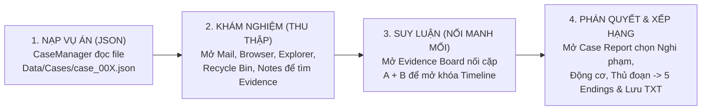
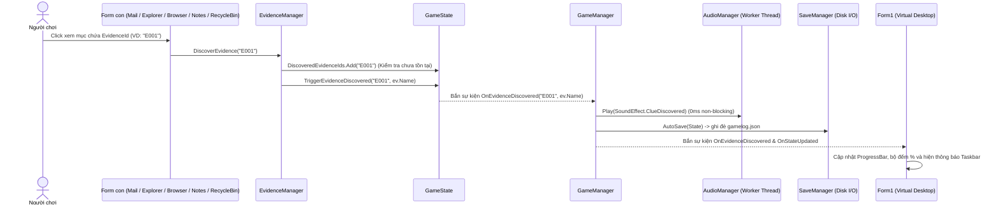
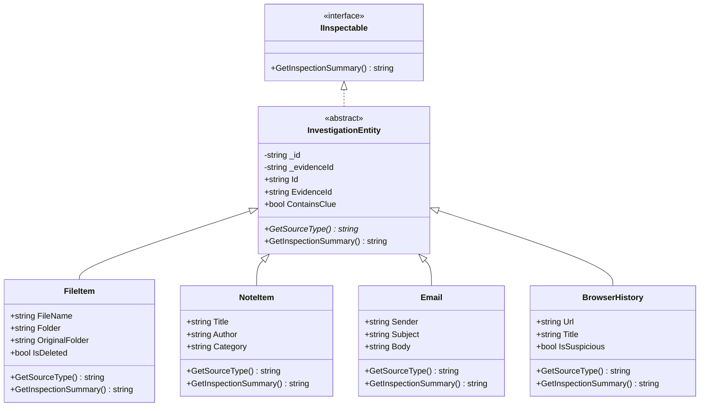
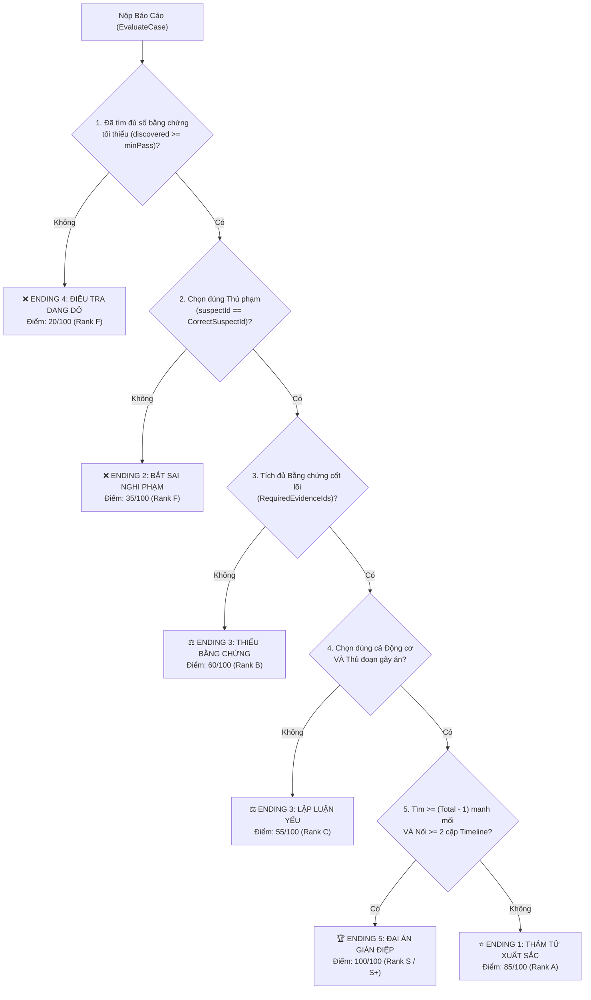

# TÀI LIỆU CẨM NANG KIẾN TRÚC, CÔNG NGHỆ & THUẬT TOÁN DỰ ÁN (DÀNH CHO 4 THÀNH VIÊN)
## DESKTOP DETECTIVE — TRÒ CHƠI TRINH THÁM KỸ THUẬT SỐ (C# .NET 10 WINFORMS)

> **Môn học:** Lập trình Windows  
> **Nền tảng & Công nghệ:** .NET 10.0 (`net10.0-windows`), C# 13, Windows Forms, System.Text.Json, NAudio 3.1.0  
> **Danh sách 4 thành viên & Vai trò cốt lõi:**  
> 1. **Hồ Minh Nhật** (`51.01.104.065`) — *Kiến trúc Hệ thống, Game Engine, Đa luồng & Thuật toán Nghiệp vụ (`Game/`, `Models/`)*  
> 2. **Trần Ngọc Hà** (`51.01.104.020`) — *Thiết kế Giao diện Hệ điều hành ảo, Responsive Layout Engine & 12 Biểu mẫu (`Form1.cs`, `Forms/`)*  
> 3. **Đào Khánh Trúc** (`51.01.104.109`) — *Kiến trúc Dữ liệu Động (100% Data-Driven JSON), Kịch bản Pháp y 4 Vụ án & Luật Suy luận (`Data/Cases/*.json`)*  
> 4. **Phan Thị Trang** (`51.01.104.102`) — *Kiểm thử Hộp đen/Hộp trắng, Bảng Vàng Thành tích (`HighScoreManager`), Xử lý Ngoại lệ I/O & Tài liệu Báo cáo*

---

## MỤC LỤC ĐỌC NHANH (QUICK NAVIGATION)

1. **[PHẦN 1: HIỂU TOÀN BỘ DỰ ÁN TRONG 5 PHÚT (BỨC TRANH TỔNG THỂ)](#phần-1-hiểu-toàn-bộ-dự-án-trong-5-phút-bức-tranh-tổng-thể)**
2. **[PHẦN 2: KIẾN TRÚC HỆ THỐNG & LUỒNG HOẠT ĐỘNG (SYSTEM ARCHITECTURE)](#phần-2-kiến-trúc-hệ-thống--luồng-hoạt-động-system-architecture)**
3. **[PHẦN 3: NGĂN XẾP CÔNG NGHỆ & KỸ THUẬT CỐT LÕI (TECH STACK & OOP/PATTERNS)](#phần-3-ngăn-xếp-công-nghệ--kỹ-thuật-cốt-lõi-tech-stack--ooppatterns)**
4. **[PHẦN 4: GIẢI PHẪU CHI TIẾT 12 THUẬT TOÁN TRONG DỰ ÁN (ALGORITHMS DEEP-DIVE)](#phần-4-giải-phẫu-chi-tiết-12-thuật-toán-trong-dự-án-algorithms-deep-dive)**
5. **[PHẦN 5: CẨM NANG CHUYÊN SÂU CHO TỪNG THÀNH VIÊN (4 ROLES PLAYBOOK)](#phần-5-cẩm-nang-chuyên-sâu-cho-từng-thành-viên-4-roles-playbook)**
6. **[PHẦN 6: BỘ CÂU HỎI & TRẢ LỜI VẤN ĐÁP BẢO VỆ ĐỀ TÀI (Q&A CHEAT SHEET)](#phần-6-bộ-câu-hỏi--trả-lời-vấn-đáp-bảo-vệ-đề-tài-qa-cheat-sheet)**

---

## PHẦN 1: HIỂU TOÀN BỘ DỰ ÁN TRONG 5 PHÚT (BỨC TRANH TỔNG THỂ)

### 1.1. Dự án này làm gì? (Ý tưởng cốt lõi)
**Desktop Detective** biến cửa sổ ứng dụng WinForms thành **màn hình máy tính cá nhân (Virtual OS Desktop)** của nạn nhân trong một vụ án công nghệ cao. Người chơi vào vai điều tra viên pháp y kỹ thuật số (Digital Forensics Investigator), mở các ứng dụng trên màn hình máy tính nạn nhân để tìm manh mối, nối các manh mối lại với nhau trên bảng suy luận và nộp cáo trạng kết tội thủ phạm.

### 1.2. Chu trình 1 ván chơi diễn ra như thế nào? (Core Game Loop)
Hãy tưởng tượng toàn bộ dự án vận hành đúng theo **4 bước tuần tự** sau:



1. **Bước 1 — Nạp Vụ Án (`CaseManager`):** Khi mở game (hoặc chọn màn chơi mới trong `CaseSelectForm`), hệ thống đọc file JSON trong thư mục `Data/Cases/` (ví dụ `case_001.json` đến `case_004.json`). Mọi email, file, lịch sử web, ghi chú, nghi phạm, bằng chứng và thậm chí cả **ứng dụng nào bị khóa** (`DisabledApps`) đều được nạp động 100% từ JSON vào bộ nhớ.
2. **Bước 2 — Khám Nghiệm & Thu Thập (`EvidenceManager`):** Người chơi bấm nút **`▶ BẮT ĐẦU`** trên `Form1` để đồng hồ bắt đầu đếm giây. Khi người chơi click vào một Email, một dòng Lịch sử Web, một File, hoặc một Sticky Note có chứa `EvidenceId` (ví dụ `"E001"`), hàm `EvidenceManager.DiscoverEvidence("E001")` sẽ được gọi:
   * Đánh dấu manh mối `"E001"` đã tìm thấy vào `GameState.DiscoveredEvidenceIds`.
   * Phát âm thanh `clue.wav` qua luồng âm thanh nền (`AudioManager`).
   * Tự động lưu ngay tiến trình xuống file `gamelog.json` (`SaveManager`).
   * Cập nhật thanh tiến trình `ProgressBar` và dòng thông báo trên Taskbar của `Form1`.
3. **Bước 3 — Suy Luận & Dựng Dòng Thời Gian (`TimelineManager`):** Người chơi mở `EvidenceBoardForm`, chọn 2 bằng chứng `A` và `B` rồi bấm **Kết nối**. `TimelineManager.TryConnectEvidences(A, B)` đối chiếu với tập luật `ConnectionRules` trong JSON (không phân biệt thứ tự A-B hay B-A). Nếu đúng, hệ thống báo suy luận thành công và ghi nhận liên kết vào `GameState.ConnectedEvidencePairs`.
4. **Bước 4 — Kết Luận & Ghi Bảng Vàng (`CaseManager` + `HighScoreManager`):** Người chơi mở `CaseReportForm`, chọn **Nghi phạm + Động cơ + Thủ đoạn + Tích chọn các bằng chứng cốt lõi**. Hàm `CaseManager.EvaluateCase()` chạy **Cây Quyết định (Decision Tree)** trả về **1 trong 5 Kết thúc (Endings)** cùng số điểm (`20`, `35`, `55`, `60`, `85`, hoặc `100`). Sau đó `HighScoreManager` tính Rank (`S+`, `S`, `A`, `B`, `C`, `F`) và ghi vào file văn bản `highscores.txt`.

---

## PHẦN 2: KIẾN TRÚC HỆ THỐNG & LUỒNG HOẠT ĐỘNG (SYSTEM ARCHITECTURE)

### 2.1. Kiến trúc Phân tầng 4 Lớp (4-Layer Architecture)
Dự án tách biệt hoàn toàn **Giao diện (UI)**, **Nghiệp vụ (Game Logic)**, **Mô hình dữ liệu (Models)** và **Lưu trữ (Persistence)**. Không có bất kỳ kịch bản vụ án nào bị đóng cứng (hardcode) trong các Form giao diện!

```
┌──────────────────────────────────────────────────────────────────────────────┐
│                     1. PRESENTATION LAYER (TẦNG GIAO DIỆN)                   │
│  • Form1.cs: Màn hình Desktop ảo, Taskbar, Đồng hồ, Khởi chạy 9 ứng dụng     │
│  • Nhóm App Điều tra: ExplorerForm, BrowserForm, MailForm, RecycleBinForm,   │
│                       NotesForm, Search (InputBox)                           │
│  • Nhóm App Phá án:   EvidenceBoardForm, CaseReportForm, CaseSelectForm      │
│  • Nhóm App Hệ thống: HighScoreForm, GuideForm, AboutForm, CreditsForm       │
└──────────────────────────────────────┬───────────────────────────────────────┘
                                       │ Giao tiếp qua Singleton & C# Events
                                       ▼
┌──────────────────────────────────────────────────────────────────────────────┐
│               2. BUSINESS LOGIC LAYER (TẦNG ĐIỀU PHỐI & NGHIỆP VỤ)           │
│  • GameManager.cs:      Singleton điều phối trung tâm, FileSystemWatcher     │
│  • CaseManager.cs:      Bộ nạp JSON động & Cây quyết định chấm điểm 5 Ending │
│  • EvidenceManager.cs:  Kho bằng chứng O(1) & Mở khóa manh mối (Idempotent)  │
│  • TimelineManager.cs:  Bộ suy luận kết nối cặp bằng chứng 2 chiều (A <-> B) │
│  • AudioManager.cs:     Audio Engine đa luồng (Worker Thread + NAudio + DSP) │
│  • SaveManager.cs:      Tuần tự hóa/Giải tuần tự hóa JSON (AutoSave/Manual)  │
│  • HighScoreManager.cs: Đọc/ghi file highscores.txt, Xếp hạng đa tiêu chí    │
└──────────────────────────────────────┬───────────────────────────────────────┘
                                       │ Thao tác trên các đối tượng thực thể
                                       ▼
┌──────────────────────────────────────────────────────────────────────────────┐
│                     3. DOMAIN & MODEL LAYER (TẦNG DỮ LIỆU)                   │
│  • IInspectable (Interface) ◄── InvestigationEntity (Abstract Base Class)    │
│       ├── FileItem (Tệp tin hệ thống & Thùng rác)                            │
│       ├── Email (Thư điện tử nội bộ)                                         │
│       ├── BrowserHistory (Lịch sử duyệt web)                                 │
│       └── NoteItem (Ghi chú Sticky Notes trên máy nạn nhân)                  │
│  • Thực thể khác: Evidence, Suspect, TimelineEntry, EvidenceConnectionRule   │
│  • Trạng thái & Gói: GameState, CasePackage, CaseData, InvestigationResult   │
└──────────────────────────────────────┬───────────────────────────────────────┘
                                       │ Đọc / Ghi File I/O
                                       ▼
┌──────────────────────────────────────────────────────────────────────────────┐
│                  4. PERSISTENCE LAYER (TẦNG LƯU TRỮ VẬT LÝ)                  │
│  • Data/Cases/case_001..004.json : Dữ liệu 4 vụ án độc lập (Data-Driven)     │
│  • gamelog.json                  : File lưu tiến trình tự động (Auto-Save)   │
│  • savegame.json                 : File lưu trạng thái thủ công              │
│  • highscores.txt                : Bảng vàng thành tích định dạng khối TXT   │
│  • Sounds/*.wav, bgm.mp3         : Tài nguyên âm thanh                       │
└──────────────────────────────────────────────────────────────────────────────┘
```

### 2.2. Bản đồ Thư mục & Vai trò Từng File Mã nguồn

| Thư mục / Tệp tin | Số dòng | Chức năng chính & Mối liên hệ | Thành viên phụ trách chính |
|---|:---:|---|---|
| [`Program.cs`](file:///D:/Projects/ltw/2611_WIN_B3/Program.cs) | 20 | Điểm khởi chạy ứng dụng (`Main`), bật cấu hình HighDPI và mở `Form1`. | Hồ Minh Nhật |
| [`Form1.cs`](file:///D:/Projects/ltw/2611_WIN_B3/Form1.cs) | 848 | Màn hình Desktop OS ảo, quản lý vòng đời trạng thái (`NotStarted`/`InProgress`/`Paused`/`Completed`), layout động, mở các app con. | Trần Ngọc Hà & Hồ Minh Nhật |
| [`Game/GameManager.cs`](file:///D:/Projects/ltw/2611_WIN_B3/Game/GameManager.cs) | 252 | **Trái tim của hệ thống** (Singleton): giữ `State`, `CaseManager`, `EvidenceManager`, `TimelineManager`, và giám sát file `gamelog.json`. | Hồ Minh Nhật |
| [`Game/GameState.cs`](file:///D:/Projects/ltw/2611_WIN_B3/Game/GameState.cs) | 49 | Lưu toàn bộ tiến trình đang chơi: các `HashSet<string>` lưu ID đã khám phá, thời gian chơi `ElapsedSeconds`, ghi chú thám tử, và phát sự kiện. | Hồ Minh Nhật |
| [`Game/CaseManager.cs`](file:///D:/Projects/ltw/2611_WIN_B3/Game/CaseManager.cs) | 773 | Nạp tất cả file JSON vụ án từ `Data/Cases`, chuẩn hóa dữ liệu mặc định, đồng bộ file thùng rác, nhập JSON ngoài và chấm điểm 5 Endings. | Hồ Minh Nhật & Đào Khánh Trúc |
| [`Game/EvidenceManager.cs`](file:///D:/Projects/ltw/2611_WIN_B3/Game/EvidenceManager.cs) | 173 | Quản lý từ điển `Dictionary<string, Evidence>`, xử lý mở khóa manh mối không trùng lặp (`DiscoverEvidence`). | Hồ Minh Nhật |
| [`Game/TimelineManager.cs`](file:///D:/Projects/ltw/2611_WIN_B3/Game/TimelineManager.cs) | 149 | Kiểm tra kết nối cặp manh mối `TryConnectEvidences(idA, idB)` và lọc danh sách mốc thời gian đã mở khóa. | Hồ Minh Nhật |
| [`Game/AudioManager.cs`](file:///D:/Projects/ltw/2611_WIN_B3/Game/AudioManager.cs) | 768 | Hệ thống âm thanh đa luồng (`ConcurrentQueue` + `Thread`), phát nhạc nền lặp vô tận (`LoopStream`), tự tổng hợp sóng âm WAV (DSP) nếu thiếu file. | Hồ Minh Nhật |
| [`Game/SaveManager.cs`](file:///D:/Projects/ltw/2611_WIN_B3/Game/SaveManager.cs) | 151 | Ghi/đọc `GameState` ra file `gamelog.json` (tự động) và `savegame.json` (thủ công) bằng `System.Text.Json`. | Phan Thị Trang & Hồ Minh Nhật |
| [`Game/HighScoreManager.cs`](file:///D:/Projects/ltw/2611_WIN_B3/Game/HighScoreManager.cs) | 260 | Tính Rank (`S+` đến `F`), phân tích cú pháp (Parser) đọc/ghi file `highscores.txt`, sắp xếp đa tiêu chí. | Phan Thị Trang |
| [`Models/InvestigationEntity.cs`](file:///D:/Projects/ltw/2611_WIN_B3/Models/InvestigationEntity.cs) | 77 | Khai báo interface `IInspectable` và lớp trừu tượng `InvestigationEntity` (nền tảng OOP của dự án). | Hồ Minh Nhật |
| [`Models/CaseData.cs`](file:///D:/Projects/ltw/2611_WIN_B3/Models/CaseData.cs) | 244 | Định nghĩa `FileItem`, `NoteItem`, `TimelineEntry`, `EvidenceConnectionRule`, `CaseData`, `CasePackage`. | Đào Khánh Trúc & Hồ Minh Nhật |
| [`Models/Email.cs`](file:///D:/Projects/ltw/2611_WIN_B3/Models/Email.cs), [`BrowserHistory.cs`](file:///D:/Projects/ltw/2611_WIN_B3/Models/BrowserHistory.cs), [`Evidence.cs`](file:///D:/Projects/ltw/2611_WIN_B3/Models/Evidence.cs), [`Suspect.cs`](file:///D:/Projects/ltw/2611_WIN_B3/Models/Suspect.cs) | ~310 | Các lớp thực thể dữ liệu với đầy đủ đóng gói (`private` field + `public` property validation). | Đào Khánh Trúc & Hồ Minh Nhật |
| [`Forms/ExplorerForm.cs`](file:///D:/Projects/ltw/2611_WIN_B3/Forms/ExplorerForm.cs) & [`RecycleBinForm.cs`](file:///D:/Projects/ltw/2611_WIN_B3/Forms/RecycleBinForm.cs) | 442 | Duyệt cây thư mục ảo (`TreeView`), đọc nội dung file, và khôi phục file bị xóa từ Thùng rác về thư mục gốc. | Trần Ngọc Hà |
| [`Forms/MailForm.cs`](file:///D:/Projects/ltw/2611_WIN_B3/Forms/MailForm.cs), [`BrowserForm.cs`](file:///D:/Projects/ltw/2611_WIN_B3/Forms/BrowserForm.cs), [`NotesForm.cs`](file:///D:/Projects/ltw/2611_WIN_B3/Forms/NotesForm.cs) | 549 | Đọc email nội bộ, kiểm tra lịch sử duyệt web (`DataGridView`), đọc Sticky Notes của nạn nhân & ghi chép sổ tay cá nhân. | Trần Ngọc Hà |
| [`Forms/EvidenceBoardForm.cs`](file:///D:/Projects/ltw/2611_WIN_B3/Forms/EvidenceBoardForm.cs) & [`CaseReportForm.cs`](file:///D:/Projects/ltw/2611_WIN_B3/Forms/CaseReportForm.cs) | 634 | Bảng nối manh mối mở khóa Timeline và Biểu mẫu nộp kết luận vụ án để nhận phán quyết. | Trần Ngọc Hà |
| [`Forms/CaseSelectForm.cs`](file:///D:/Projects/ltw/2611_WIN_B3/Forms/CaseSelectForm.cs), [`HighScoreForm.cs`](file:///D:/Projects/ltw/2611_WIN_B3/Forms/HighScoreForm.cs), [`GuideForm.cs`](file:///D:/Projects/ltw/2611_WIN_B3/Forms/GuideForm.cs), [`AboutForm.cs`](file:///D:/Projects/ltw/2611_WIN_B3/Forms/AboutForm.cs), [`CreditsForm.cs`](file:///D:/Projects/ltw/2611_WIN_B3/Forms/CreditsForm.cs) | ~690 | Chọn vụ án / Import JSON mới, xem bảng vàng thành tích, xem hướng dẫn 4 chương, thông tin đồ án & thành viên. | Trần Ngọc Hà & Phan Thị Trang |
| `Data/Cases/case_001.json` $\to$ `case_004.json` | ~1100 | 4 gói dữ liệu vụ án hoàn chỉnh từ mức độ Dễ $\to$ Trung bình $\to$ Khó $\to$ Chuyên gia (Air-Gapped). | Đào Khánh Trúc |

### 2.3. Luồng Sự kiện Phản xạ (Event-Driven Flow)
Khi người chơi tìm thấy một manh mối ở **bất kỳ Form con nào**, Form con đó **KHÔNG CẦN** gọi trực tiếp tới `Form1` hay `SaveManager` hay `AudioManager`. Thay vào đó, mọi thứ tự động lan truyền qua sự kiện (Observer Pattern):



### 2.4. Máy Trạng thái Vòng đời Điều tra (Investigation State Machine)
Trạng thái ván chơi được quản lý bởi enum `InvestigationStatus` trong [`GameState.cs`](file:///D:/Projects/ltw/2611_WIN_B3/Game/GameState.cs#L6-L12) và đồng bộ giao diện qua hàm `Form1.SetInvestigationStatus()`:

* **`NotStarted` (Chưa bắt đầu):** Khi mới mở game hoặc mới chuyển vụ án. Toàn bộ 8 icon ứng dụng điều tra bị khóa (`Enabled = false`, `Cursor = Cursors.No`), trừ `GuideForm` luôn mở để xem hướng dẫn. Đồng hồ đứng yên ở `00:00`. Nút chính hiện **`▶ BẮT ĐẦU`** màu xanh lá.
* **`InProgress` (Đang điều tra):** Khi bấm **`▶ BẮT ĐẦU`**. Toàn bộ icon ứng dụng được mở khóa (`Enabled = true`, `Cursor = Cursors.Hand`). Mỗi giây `systemTimer_Tick` tăng `State.ElapsedSeconds++`. Nút chính đổi thành **`⏸ TẠM DỪNG ▾`**.
* **`Paused` (Tạm dừng):** Khi người chơi chọn tạm dừng, hoặc **khi tắt game mở lại từ file `gamelog.json` đang chơi dở** (xem [`GameManager.cs#L56-L59`](file:///D:/Projects/ltw/2611_WIN_B3/Game/GameManager.cs#L56-L59)). Các ứng dụng tạm khóa và đồng hồ ngừng đếm để bảo đảm công bằng thời gian phá án.
* **`Completed` (Đã kết thúc):** Sau khi nộp báo cáo tại `CaseReportForm`. Đồng hồ dừng lại, ghi kỷ lục vào `highscores.txt`, nút chính đổi thành **`🏁 ĐÃ KẾT THÚC ▾`** cho phép chơi lại hoặc đổi vụ án khác.

---

## PHẦN 3: NGĂN XẾP CÔNG NGHỆ & KỸ THUẬT CỐT LÕI (TECH STACK & OOP/PATTERNS)

### 3.1. Công nghệ & Cấu hình Nền tảng ([`2611_WIN_B3.csproj`](file:///D:/Projects/ltw/2611_WIN_B3/2611_WIN_B3.csproj))
* **Framework:** `.NET 10.0` (`net10.0-windows`) với C# 13 (`Nullable = enable`, `ImplicitUsings = enable`).
* **Độ phân giải cao (High-DPI):** `<ApplicationHighDpiMode>PerMonitorV2</ApplicationHighDpiMode>` giúp giao diện sắc nét, không bị nhòe chữ trên màn hình laptop 2K/4K (tỷ lệ scale Windows 125% - 150%).
* **Thư viện âm thanh:** `NAudio 3.1.0` dùng `AudioFileReader` và `WaveOut` để giải mã trực tiếp luồng âm thanh MP3/WAV và điều chỉnh âm lượng độc lập cho từng kênh (`_bgmVolume = 0.30f`, `_sfxVolume = 1.40f`, `_clueVolume = 2.50f`).

### 3.2. Bốn Trụ cột Lập trình Hướng đối tượng (OOP) trong Dự án
Đây là phần **quan trọng bậc nhất khi bảo vệ đồ án**. Mọi thành viên cần nắm rõ bảng ánh xạ này:

| Trụ cột OOP | Cách hiện thực trong dự án | File & Dòng code minh chứng |
|---|---|---|
| **1. Đóng gói (Encapsulation)** | Tất cả các lớp trong `Models/` đều dùng biến thành viên `private` (`_id`, `_name`, `_evidenceId`...) kết hợp `public property` (`get`/`set`). Trong `set` có kiểm tra dữ liệu đầu vào: nếu chuỗi rỗng thì ném `ArgumentException`, tự động `.Trim()` hoặc `.ToUpperInvariant()`. Trong `EvidenceManager`, từ điển `_evidences` là `private readonly`, bên ngoài chỉ truy cập qua hàm. | [`InvestigationEntity.cs#L20-L45`](file:///D:/Projects/ltw/2611_WIN_B3/Models/InvestigationEntity.cs#L20-L45)<br/>[`Evidence.cs#L15-L75`](file:///D:/Projects/ltw/2611_WIN_B3/Models/Evidence.cs#L15-L75)<br/>[`Suspect.cs#L15-L75`](file:///D:/Projects/ltw/2611_WIN_B3/Models/Suspect.cs#L15-L75) |
| **2. Kế thừa (Inheritance)** | Lớp cơ sở trừu tượng `InvestigationEntity` định nghĩa các thuộc tính chung của mọi vật chứng số: `Id`, `EvidenceId`, `ContainsClue`. **4 lớp con** kế thừa trực tiếp từ `InvestigationEntity` gồm: `FileItem`, `NoteItem`, `Email`, `BrowserHistory`. | [`InvestigationEntity.cs#L18`](file:///D:/Projects/ltw/2611_WIN_B3/Models/InvestigationEntity.cs#L18)<br/>[`CaseData.cs#L5`](file:///D:/Projects/ltw/2611_WIN_B3/Models/CaseData.cs#L5) (`FileItem`)<br/>[`CaseData.cs#L86`](file:///D:/Projects/ltw/2611_WIN_B3/Models/CaseData.cs#L86) (`NoteItem`)<br/>[`Email.cs#L9`](file:///D:/Projects/ltw/2611_WIN_B3/Models/Email.cs#L9)<br/>[`BrowserHistory.cs#L9`](file:///D:/Projects/ltw/2611_WIN_B3/Models/BrowserHistory.cs#L9) |
| **3. Đa hình (Polymorphism)** | `InvestigationEntity` khai báo phương thức thuần ảo `public abstract string GetSourceType()` và phương thức ảo `public virtual string GetInspectionSummary()`. Mỗi lớp con `override` lại theo đặc thù riêng: `FileItem` trả về `"Recycle Bin"` hoặc `"File System"` tùy biến `IsDeleted`; `NoteItem` trả về `"Sticky Notes / Memos"`; `Email` trả về `"Mail Client"`; `BrowserHistory` trả về `"Web Browser"`. | [`InvestigationEntity.cs#L64-L73`](file:///D:/Projects/ltw/2611_WIN_B3/Models/InvestigationEntity.cs#L64-L73)<br/>[`CaseData.cs#L75-L80`](file:///D:/Projects/ltw/2611_WIN_B3/Models/CaseData.cs#L75-L80) |
| **4. Trừu tượng (Abstraction)** | Giao diện `IInspectable` quy định hợp đồng hành vi `GetInspectionSummary()`. Lớp trừu tượng `InvestigationEntity` và `WaveStream` (trong `LoopStream`) che giấu chi tiết cài đặt bên dưới. | [`InvestigationEntity.cs#L8-L11`](file:///D:/Projects/ltw/2611_WIN_B3/Models/InvestigationEntity.cs#L8-L11)<br/>[`AudioManager.cs#L714`](file:///D:/Projects/ltw/2611_WIN_B3/Game/AudioManager.cs#L714) |



### 3.3. 6 Mẫu Thiết kế Phần mềm (Design Patterns) Đã Áp dụng
1. **Thread-Safe Singleton Pattern (`Lazy<T>`):** Dùng ở `GameManager.Instance` ([`GameManager.cs#L17-L23`](file:///D:/Projects/ltw/2611_WIN_B3/Game/GameManager.cs#L17-L23)) và `AudioManager.Instance` ([`AudioManager.cs#L30-L31`](file:///D:/Projects/ltw/2611_WIN_B3/Game/AudioManager.cs#L30-L31)). Đảm bảo toàn chương trình chỉ có đúng 1 bộ điều phối game và 1 bộ phát âm thanh, an toàn đa luồng tuyệt đối.
2. **Observer Pattern (Publish-Subscribe qua Events):** `GameState` và `GameManager` phát sự kiện (`OnEvidenceDiscovered`, `OnNotification`, `OnStateUpdated`, `OnGameReset`), còn `Form1` và `ExplorerForm` đăng ký lắng nghe để tự làm mới UI.
3. **Producer-Consumer Pattern (Hàng đợi Đa luồng):** Trong `AudioManager`, luồng giao diện chính (UI Thread) là **Producer** đẩy lệnh phát nhạc vào `ConcurrentQueue<Action>` rồi thoát ngay lập tức (0ms). Luồng chạy ngầm `AudioEngine_WorkerThread` là **Consumer** chờ tín hiệu từ `AutoResetEvent` để lấy lệnh ra phát âm thanh.
4. **Repository Pattern:** `EvidenceManager` đóng gói `Dictionary<string, Evidence>`, cung cấp các hàm truy vấn `GetEvidence(id)`, `GetAllEvidences()`, `GetDiscoveredEvidences()` sử dụng `yield return` (Deferred Execution).
5. **Decorator / Wrapper Pattern:** Lớp `LoopStream` kế thừa `WaveStream` và bọc quanh `AudioFileReader` để tự động tua `Position = 0` khi đọc hết luồng nhạc nền.
6. **Data-Driven Architecture (Kiến trúc Hướng dữ liệu 100%):** Toàn bộ nội dung vụ án, luật nối bằng chứng, danh sách nghi phạm, và cả cấu hình khóa ứng dụng (`DisabledApps`, `AppLockReasons`) nằm hoàn toàn trong file JSON (`CasePackage`), cho phép thêm màn chơi mới mà không cần sửa 1 dòng code C# nào.

---

## PHẦN 4: GIẢI PHẪU CHI TIẾT 12 THUẬT TOÁN TRONG DỰ ÁN (ALGORITHMS DEEP-DIVE)

Dưới đây là toàn bộ 12 thuật toán cốt lõi được cài đặt trong mã nguồn, trình bày theo cấu trúc: **Mục đích $\to$ Vị trí code $\to$ Nguyên lý từng bước $\to$ Độ phức tạp**.

---

### Thuật toán 1: Cây Quyết định Chấm điểm & Phân nhánh 5 Kết thúc (Decision Tree Evaluation)
* **Vị trí:** [`CaseManager.cs#L519-L721`](file:///D:/Projects/ltw/2611_WIN_B3/Game/CaseManager.cs#L519-L721) — Hàm `EvaluateCase()`
* **Độ phức tạp:** Thời gian $O(M)$ với $M$ là số bằng chứng bắt buộc (`RequiredEvidenceIds.Count`); Không gian $O(1)$.
* **Nguyên lý hoạt động (Kiểm tra qua 5 tầng lọc ưu tiên từ thấp đến cao):**
  1. **Tầng 1 — Kiểm tra ngưỡng bằng chứng tối thiểu (`MinEvidenceForPass`):**
     Nếu số bằng chứng đã khám phá `discoveredCount < minPass` $\implies$ Trả về ngay **ENDING 4: ĐIỀU TRA DANG DỞ (20 điểm)** (Hồ sơ quá sơ sài, bị Viện kiểm sát trả về).
  2. **Tầng 2 — Kiểm tra định danh Nghi phạm (`CorrectSuspectId`):**
     Nếu chọn sai nghi phạm (`!suspectId.Equals(CorrectSuspectId)`) $\implies$ Trả về ngay **ENDING 2: BẮT SAI NGHI PHẠM (35 điểm)** (Bắt oan người có alibi, hung thủ thật tẩu thoát).
  3. **Tầng 3 — Kiểm tra Bằng chứng vật chứng cốt lõi (`RequiredEvidenceIds`):**
     Duyệt qua danh sách `RequiredEvidenceIds` của vụ án. Nếu người chơi quên tích chọn bất kỳ bằng chứng cốt lõi nào trong `CheckedListBox` $\implies$ Trả về **ENDING 3: THIẾU BẰNG CHỨNG THUYẾT PHỤC (60 điểm)** (Đoán đúng thủ phạm nhưng luật sư bào chữa thành công tại tòa).
  4. **Tầng 4 — Kiểm tra Lập luận Động cơ & Thủ đoạn (`CorrectMotive` & `CorrectMethod`):**
     So sánh chuỗi Động cơ và Thủ đoạn người chơi chọn với đáp án. Nếu sai 1 trong 2 $\implies$ Trả về **ENDING 3: LẬP LUẬN THIẾU THUYẾT PHỤC (55 điểm)**.
  5. **Tầng 5 — Phân loại Kết thúc Xuất sắc (`Standard` vs `Mastery Secret Ending`):**
     * Nếu khám phá gần như toàn bộ bằng chứng (`discoveredCount >= totalPossible - 1`) **VÀ** nối đúng ít nhất `requiredConnections = Math.Min(2, ConnectionRules.Count)` cặp suy luận trên Evidence Board $\implies$ Mở khóa kết thúc ẩn **ENDING 5: ĐẠI ÁN GIÁN ĐIỆP / THE BIGGER CASE (100 điểm)**.
     * Ngược lại $\implies$ Trả về **ENDING 1: THÁM TỬ XUẤT SẮC / CORRECT DETECTIVE (85 điểm)**.



---

### Thuật toán 2: Suy luận Luật Tương quan Hai chiều & Chuẩn hóa Khóa Đối xứng (Bidirectional Rule Matching)
* **Vị trí:** [`TimelineManager.cs#L92-L122`](file:///D:/Projects/ltw/2611_WIN_B3/Game/TimelineManager.cs#L92-L122) — Hàm `TryConnectEvidences(string idA, string idB, out string message)`
* **Bài toán:** Khi người chơi nối bằng chứng `E001` với `E004`, hoặc nối `E004` với `E001`, hệ thống phải hiểu đó là **cùng một mối liên hệ** và không được tính trùng 2 lần.
* **Giải pháp toán học:**
  1. **Kiểm tra phản xạ:** Nếu `idA == idB` $\to$ báo lỗi không thể nối chính nó.
  2. **Chuẩn hóa khóa bất biến thứ tự (Canonical Pair Key):** Dùng so sánh chuỗi `string.CompareOrdinal(idA, idB) < 0` để luôn xếp mã nhỏ hơn đứng trước:
     $$\text{pairKey} = \min(idA, idB) + \text{"+"} + \max(idA, idB)$$
     Ví dụ: Dù chọn `(E004, E001)` hay `(E001, E004)` thì `pairKey` luôn là `"E001+E004"`.
  3. **Kiểm tra trùng lặp:** Tra cứu `pairKey` trong `ConnectedEvidencePairs`.
  4. **Đối sánh hai chiều trên tập luật `_rules`:**
     `(r.EvidenceA == idA && r.EvidenceB == idB) || (r.EvidenceA == idB && r.EvidenceB == idA)`
* **Độ phức tạp:** Thời gian $O(R)$ với $R$ là số luật của vụ án ($R \approx 3\text{–}5 \implies O(1)$).

---

### Thuật toán 3: Khám phá Manh mối Bất biến Lặp (Idempotent Evidence Discovery)
* **Vị trí:** [`EvidenceManager.cs#L135-L146`](file:///D:/Projects/ltw/2611_WIN_B3/Game/EvidenceManager.cs#L135-L146) — Hàm `DiscoverEvidence(string id)`
* **Bài toán:** Người chơi có thể click đi click lại vào cùng một email hoặc một tập tin hàng chục lần. Làm sao để chỉ tính điểm, phát âm thanh và bắn thông báo **đúng lần đầu tiên** với tốc độ nhanh nhất?
* **Giải pháp:** Kết hợp cấu trúc bảng băm `Dictionary<string, Evidence>` và tập hợp `HashSet<string> DiscoveredEvidenceIds`:
  * Bước 1: Kiểm tra `_evidences.ContainsKey(id)` tốn $O(1)$.
  * Bước 2: Gọi `_state.DiscoveredEvidenceIds.Add(id)`. Phương thức `.Add()` của `HashSet<T>` trong .NET vừa kiểm tra tồn tại vừa chèn phần tử trong **$O(1)$**: trả về `true` nếu là phần tử mới, trả về `false` nếu đã có.
  * Bước 3: Chỉ khi `.Add(id) == true`, hệ thống mới gán `IsDiscovered = true` và phát sự kiện `TriggerEvidenceDiscovered`.

---

### Thuật toán 4: Xếp hạng Bảng Vàng Đa tiêu chí (Multi-Criteria Leaderboard Sorting)
* **Vị trí:** [`HighScoreManager.cs#L202-L206`](file:///D:/Projects/ltw/2611_WIN_B3/Game/HighScoreManager.cs#L202-L206) — Hàm `LoadScores()`
* **Độ phức tạp:** $O(N \log N)$ với $N$ là số kỷ lục trong file `highscores.txt`.
* **Nguyên lý:** Sử dụng chuỗi toán tử sắp xếp đa khóa (Multi-key LINQ Sorting):
  1. **Tiêu chí 1 (`OrderByDescending(x => x.Score)`):** Người có **Điểm số cao hơn** xếp trên.
  2. **Tiêu chí 2 (`ThenBy(x => x.ElapsedSeconds)`):** Nếu bằng điểm nhau, người có **Thời gian phá án ngắn hơn (ít giây hơn)** xếp trên.
  3. **Tiêu chí 3 (`ThenByDescending(x => x.Date)`):** Nếu trùng cả điểm lẫn số giây, kỷ lục **mới lập gần nhất** xếp trên.

---

### Thuật toán 5: Phân lớp Xếp hạng Danh hiệu Thám tử (Multi-Threshold Rank Classification)
* **Vị trí:** [`HighScoreManager.cs#L33-L43`](file:///D:/Projects/ltw/2611_WIN_B3/Game/HighScoreManager.cs#L33-L43) — Hàm `HighScoreEntry.CalculateRank(int score, int elapsedSeconds)`
* **Độ phức tạp:** $O(1)$.
* **Quy tắc phân lớp:**
  * `score >= 100` **và** `elapsedSeconds <= 300` ($\le 5$ phút) $\implies$ **`S+ (Thiên tài)`**
  * `score >= 100` **và** `elapsedSeconds > 300` $\implies$ **`S (Xuất sắc)`**
  * `85 <= score < 100` $\implies$ **`A (Giỏi)`**
  * `60 <= score < 85` $\implies$ **`B (Khá)`**
  * `40 <= score < 60` $\implies$ **`C (Trung bình)`**
  * `score < 40` $\implies$ **`F (Chưa đạt)`**

---

### Thuật toán 6: Xáo trộn Phương án Nhiễu Tất định theo Hạt giống (Deterministic Seeded Shuffle)
* **Vị trí:** [`CaseReportForm.cs#L126-L127`](file:///D:/Projects/ltw/2611_WIN_B3/Forms/CaseReportForm.cs#L126-L127) & [`CaseReportForm.cs#L150-L151`](file:///D:/Projects/ltw/2611_WIN_B3/Forms/CaseReportForm.cs#L150-L151)
* **Bài toán:** Trong file JSON, đáp án đúng thường được người soạn thảo viết ở dòng đầu tiên của mảng `MotiveOptions` và `MethodOptions`. Nếu hiển thị nguyên xi lên `ComboBox`, người chơi sẽ thấy đáp án đúng luôn nằm ở dòng số 1!
* **Giải pháp:** Khởi tạo bộ sinh số giả ngẫu nhiên `Random` với hạt giống (Seed) tính từ mã băm của `CaseId`:
  ```csharp
  var rng = new Random(GameManager.Instance.CaseManager.CurrentPackage.CaseId.GetHashCode() + 1);
  var shuffled = list.OrderBy(_ => rng.Next()).ToList();
  ```
  Nhờ cộng thêm độ lệch `+ 1` (cho Động cơ) và `+ 2` (cho Thủ đoạn), thứ tự các đáp án được xáo trộn ngẫu nhiên nhưng **ổn định trong suốt phiên chơi của vụ án đó**.

---

### Thuật toán 7: Tự động Bảo toàn & Suy diễn Thực thể Dữ liệu Động (Auto-Healing Entity Normalization)
* **Vị trí:** [`CaseManager.cs#L231-L349`](file:///D:/Projects/ltw/2611_WIN_B3/Game/CaseManager.cs#L231-L349) — Hàm `InitPackageDefaults(CasePackage pkg)` & [`CaseData.cs#L26-L38`](file:///D:/Projects/ltw/2611_WIN_B3/Models/CaseData.cs#L26-L38)
* **Bài toán:** Khi thành viên thiết kế nội dung viết file JSON mới (hoặc người dùng import file JSON bên ngoài), có thể họ gắn `EvidenceId = "E999"` vào một `FileItem` hoặc `NoteItem` nhưng lại quên khai báo `"E999"` trong mảng `Evidences`, hoặc quên ghi `OriginalFolder` cho file trong thùng rác.
* **Giải pháp:**
  1. **Tự động khởi tạo mảng rỗng (`??=`):** Chống hoàn toàn lỗi `NullReferenceException` cho cả 12 danh sách trong `CasePackage`.
  2. **Tự động sinh `Evidence` còn thiếu:** Duyệt qua toàn bộ `pkg.Files` và `pkg.Notes`, nếu phát hiện `EvidenceId` chưa tồn tại trong `pkg.Evidences`, hệ thống tự động tạo mới đối tượng `Evidence` với tên, mô tả, nguồn gốc và trích xuất 5 ký tự cuối của thời gian (`ModifiedTime[^5..]`).
  3. **Suy diễn thư mục gốc bằng Heuristic (`FileItem.OriginalFolder`):** Nếu một file trong `Recycle Bin` không khai báo `OriginalFolder`, getter sẽ tự phân tích tên file: chứa `"Project"/"Nexus"/"enc"/"db"` $\to$ về `"Projects"`; chứa `"key"/"rsa"/"log"/"pem"` $\to$ về `"Work"`; chứa `"bat"/"ps1"/"sh"` $\to$ về `"Downloads"`; mặc định $\to$ về `"Documents"`.

---

### Thuật toán 8: Đồng bộ Hai chiều & Phục hồi Tập tin Thùng rác (Bi-directional File State Synchronization)
* **Vị trí:** [`CaseManager.cs#L265-L272`](file:///D:/Projects/ltw/2611_WIN_B3/Game/CaseManager.cs#L265-L272), [`CaseManager.cs#L359-L391`](file:///D:/Projects/ltw/2611_WIN_B3/Game/CaseManager.cs#L359-L391) (`SyncFileStates`) & [`RecycleBinForm.cs#L168-L209`](file:///D:/Projects/ltw/2611_WIN_B3/Forms/RecycleBinForm.cs#L168-L209)
* **Nguyên lý:**
  * Lúc nạp JSON lần đầu, mỗi `FileItem` chụp lại trạng thái gốc vào `InitialIsDeleted` và `InitialFolder`.
  * Khi người chơi bấm **"Khôi phục"** trong `RecycleBinForm`:
    1. Gán `file.IsDeleted = false` và `file.Folder = file.OriginalFolder`.
    2. Lưu `file.Id` vào `GameState.RestoredFileIds`.
    3. Gọi `GameManager.Instance.NotifyStateChanged()` $\to$ `ExplorerForm` đang mở ở dưới sẽ tự động nhận sự kiện `OnStateUpdated` và hiển thị ngay file vừa khôi phục vào đúng thư mục gốc!
  * Khi người chơi bấm **Reset Game** hoặc nạp lại file lưu: Hàm `SyncFileStates(state)` duyệt qua toàn bộ file, đối chiếu với `state.RestoredFileIds` để đặt lại chính xác file nào đang ở Thùng rác, file nào đã được cứu.

---

### Thuật toán 9: Tổng hợp Sóng âm Kỹ thuật số PCM & Tạo File WAV Tự động (Procedural DSP Waveform Synthesis)
* **Vị trí:** [`AudioManager.cs#L159-L364`](file:///D:/Projects/ltw/2611_WIN_B3/Game/AudioManager.cs#L159-L364)
* **Mục đích:** Đảm bảo game **không bao giờ bị mất tiếng hoặc crash** ngay cả khi thư mục `Sounds/` bị xóa mất các file hiệu ứng `.wav`.
* **Nguyên lý Toán học & Xử lý tín hiệu số (DSP):**
  * Nếu kiểm tra thấy thiếu bất kỳ file nào trong 5 file (`click.wav`, `notify.wav`, `connect.wav`, `win.wav`, `fail.wav`), `AudioManager` sẽ tự tổng hợp mảng mẫu âm thanh 16-bit PCM ở tần số lấy mẫu $f_s = 44100\text{ Hz}$.
  * Sử dụng công thức sóng hình sin kết hợp họa âm bậc hai (Harmonics) và hàm bao suy giảm mũ (Exponential Decay Envelope) để tạo tiếng chuông tự nhiên:
    $$y(t) = A \cdot \left[\sin(2\pi f t) + k \cdot \sin(4\pi f t)\right] \cdot e^{-t / \tau}$$
  * Ví dụ trong `GenerateWinSamples()`: Phối hợp âm hợp âm trưởng C5 ($523.25\text{ Hz}$) $\to$ E5 ($659.25\text{ Hz}$) $\to$ G5 ($783.99\text{ Hz}$) $\to$ C6 ($1046.50\text{ Hz}$).
  * Cuối cùng, hàm `WriteWavFile()` ghi trực tiếp cấu trúc nhị phân **RIFF WAVE Header** (44 bytes gồm `RIFF`, `WAVE`, `fmt `, `data` subchunk) kèm dữ liệu PCM xuống ổ cứng bằng `BinaryWriter`.

---

### Thuật toán 10: Vòng lặp Luồng Âm thanh Vô tận Không Độ trễ (Infinite Cyclic Stream Buffer - `LoopStream`)
* **Vị trí:** [`AudioManager.cs#L714-L766`](file:///D:/Projects/ltw/2611_WIN_B3/Game/AudioManager.cs#L714-L766)
* **Nguyên lý:** Ghi đè hàm `Read(byte[] buffer, int offset, int count)` của lớp `WaveStream`:
  * Chạy vòng lặp `while (totalBytesRead < count)` để đọc từng phần từ `_sourceStream`.
  * Ngay tại thời điểm đọc chạm đáy file (`bytesRead == 0`), thay vì trả về kết thúc luồng (khiến `WaveOut` dừng phát và gây tiếng khựng), thuật toán lập tức đặt lại con trỏ `_sourceStream.Position = 0` và đọc tiếp phần byte còn thiếu vào đúng buffer hiện tại. Nhạc nền `bgm.mp3` nhờ vậy phát lặp vô tận mượt mà tuyệt đối.

---

### Thuật toán 11: Cơ chế Phòng vệ Kép Giám sát Tệp Nhật ký (Dual-Defense File Liveness Trap)
* **Vị trí:** [`GameManager.cs#L114-L144`](file:///D:/Projects/ltw/2611_WIN_B3/Game/GameManager.cs#L114-L144) & [`Form1.cs#L614-L625`](file:///D:/Projects/ltw/2611_WIN_B3/Form1.cs#L614-L625)
* **Mục đích:** Theo yêu cầu đặc thù của đề tài, nếu đang chơi mà người dùng ra ngoài Windows Explorer xóa mất file `gamelog.json`, ứng dụng phải phát hiện ngay lập tức và **tự động Reset toàn bộ tiến trình về 0**.
* **Cơ chế 2 lớp bảo vệ:**
  1. **Lớp 1 — Bắt ngắt hệ điều hành (`FileSystemWatcher`):** Đăng ký lắng nghe sự kiện `_fileWatcher.Deleted` trên file `gamelog.json`. Khi file bị xóa, OS bắn interrupt gọi thẳng `ResetGame(becauseFileDeleted: true)`.
  2. **Lớp 2 — Kiểm tra nhịp tim định kỳ (`Polling Liveness Check`):** Phòng trường hợp `FileSystemWatcher` bị tràn bộ đệm sự kiện của Windows, mỗi 1 giây (`systemTimer_Tick`), `Form1` gọi `GameManager.Instance.CheckLogFileLiveness()`. Nếu `!SaveManager.LogExists() && State.DiscoveredEvidenceIds.Count > 0` $\implies$ kích hoạt `ResetGame(becauseFileDeleted: true)` ngay lập tức.

---

### Thuật toán 12: Bố cục Giao diện Thích ứng Động (Responsive Mathematical Layout Engine)
* **Vị trí:** [`Form1.cs#L171-L235`](file:///D:/Projects/ltw/2611_WIN_B3/Form1.cs#L171-L235) (`LayoutCaseBriefButtons`), [`Form1.cs#L378-L417`](file:///D:/Projects/ltw/2611_WIN_B3/Form1.cs#L378-L417) (`LayoutDesktop`), [`Form1.cs#L419-L475`](file:///D:/Projects/ltw/2611_WIN_B3/Form1.cs#L419-L475) (`LayoutTaskbar`)
* **Nguyên lý:**
  1. **Chia lưới biểu tượng Desktop bằng phép chia lấy nguyên & lấy dư (`Modulo Grid Layout`):**
     * Nếu chiều rộng màn hình `desktopW < 950` $\to$ chia `cols = 2` cột; ngược lại chia `cols = 3` cột chuẩn.
     * Vị trí của icon thứ `i` (từ 0 đến 8) được tính tự động:
       $$\text{Cột } c = i \bmod \text{cols}, \quad \text{Hàng } r = \lfloor i / \text{cols} \rfloor$$
       $$X_i = \text{startX} + c \times 175, \quad Y_i = \text{startY} + r \times 155$$
  2. **Ngắt dòng nút bấm thông minh (`Responsive Button Stacking`):**
     * Trong khung Hồ sơ vụ án (`grpCaseBrief`), nếu chiều rộng khả dụng `availW >= 580px`: Xếp cả 3 nút (`▶ BẮT ĐẦU`, `Bảng Vàng`, `Đổi Vụ Án`) nằm trên **1 hàng ngang**, trong đó nút chính chiếm `40%` diện tích, 2 nút phụ chia đôi `30% - 30%`.
     * Nếu cửa sổ bị thu hẹp (`availW < 580px`): Tự động chuyển sang **Chế độ 2 hàng** — nút `▶ BẮT ĐẦU` trải rộng `100%` ở hàng trên, 2 nút phụ chia đôi `50% - 50%` ở hàng dưới. Khung văn bản `txtCaseOverview` tự động co chiều cao theo đỉnh của hàng nút (`topOfButtons - overviewTop - 12`) để không bao giờ bị nút đè lên chữ!

---

## PHẦN 5: CẨM NANG CHUYÊN SÂU CHO TỪNG THÀNH VIÊN (4 ROLES PLAYBOOK)

Phần này được thiết kế riêng cho **từng thành viên trong nhóm 4 người**. Mỗi bạn chỉ cần đọc kỹ phần chung ở trên và **nắm lòng phần riêng của mình dưới đây** là tự tin trả lời mọi câu hỏi của giảng viên!

---

### 👤 THÀNH VIÊN 1: HỒ MINH NHẬT (`51.01.104.065`)
**Vai trò:** *Lập trình chính, Kiến trúc Hệ thống, Đa luồng & Xử lý Logic Trò chơi*

#### 1. Các file bạn cần nắm lòng:
* [`Game/GameManager.cs`](file:///D:/Projects/ltw/2611_WIN_B3/Game/GameManager.cs), [`Game/GameState.cs`](file:///D:/Projects/ltw/2611_WIN_B3/Game/GameState.cs)
* [`Game/CaseManager.cs`](file:///D:/Projects/ltw/2611_WIN_B3/Game/CaseManager.cs), [`Game/EvidenceManager.cs`](file:///D:/Projects/ltw/2611_WIN_B3/Game/EvidenceManager.cs), [`Game/TimelineManager.cs`](file:///D:/Projects/ltw/2611_WIN_B3/Game/TimelineManager.cs)
* [`Game/AudioManager.cs`](file:///D:/Projects/ltw/2611_WIN_B3/Game/AudioManager.cs)
* [`Models/InvestigationEntity.cs`](file:///D:/Projects/ltw/2611_WIN_B3/Models/InvestigationEntity.cs)

#### 2. Những điểm đắt giá nhất trong phần việc của bạn:
* **Kiến trúc Singleton + Dependency Injection thủ công:** Trong constructor của `GameManager`, bạn khởi tạo `CaseManager` trước, khôi phục `GameState` từ `gamelog.json`, rồi tiêm (inject) `State` và dữ liệu của `CurrentPackage` vào `EvidenceManager` và `TimelineManager`.
* **Xử lý đa luồng âm thanh không gây trễ giao diện (Zero-Lag Audio Engine):** Giải thích được vì sao dùng `ConcurrentQueue<Action>` + `AutoResetEvent` + `Thread` nền thay vì phát âm thanh trực tiếp trên UI Thread. Và giải thích được cơ chế dọn dẹp tài nguyên triệt để (`Shutdown()` trong `AudioManager` và `Form1_FormClosing`) để khi đóng cửa sổ `Form1`, tiến trình `.exe` tắt hẳn ngay lập tức mà không bị treo ngầm.
* **Cây quyết định 5 Endings (`EvaluateCase`)** và **Suy luận 2 chiều (`TryConnectEvidences`)**.

---

### 👤 THÀNH VIÊN 2: TRẦN NGỌC HÀ (`51.01.104.020`)
**Vai trò:** *Thiết kế Giao diện Hệ điều hành ảo (Virtual OS UI) & Bố trí 12 Biểu mẫu (Forms)*

#### 1. Các file bạn cần nắm lòng:
* [`Form1.cs`](file:///D:/Projects/ltw/2611_WIN_B3/Form1.cs) & `Form1.Designer.cs`
* Toàn bộ 11 Form con trong thư mục `Forms/`: [`ExplorerForm.cs`](file:///D:/Projects/ltw/2611_WIN_B3/Forms/ExplorerForm.cs), [`RecycleBinForm.cs`](file:///D:/Projects/ltw/2611_WIN_B3/Forms/RecycleBinForm.cs), [`MailForm.cs`](file:///D:/Projects/ltw/2611_WIN_B3/Forms/MailForm.cs), [`BrowserForm.cs`](file:///D:/Projects/ltw/2611_WIN_B3/Forms/BrowserForm.cs), [`NotesForm.cs`](file:///D:/Projects/ltw/2611_WIN_B3/Forms/NotesForm.cs), [`EvidenceBoardForm.cs`](file:///D:/Projects/ltw/2611_WIN_B3/Forms/EvidenceBoardForm.cs), [`CaseReportForm.cs`](file:///D:/Projects/ltw/2611_WIN_B3/Forms/CaseReportForm.cs), [`CaseSelectForm.cs`](file:///D:/Projects/ltw/2611_WIN_B3/Forms/CaseSelectForm.cs), [`HighScoreForm.cs`](file:///D:/Projects/ltw/2611_WIN_B3/Forms/HighScoreForm.cs), [`GuideForm.cs`](file:///D:/Projects/ltw/2611_WIN_B3/Forms/GuideForm.cs), [`AboutForm.cs`](file:///D:/Projects/ltw/2611_WIN_B3/Forms/AboutForm.cs), [`CreditsForm.cs`](file:///D:/Projects/ltw/2611_WIN_B3/Forms/CreditsForm.cs).

#### 2. Những điểm đắt giá nhất trong phần việc của bạn:
* **Làm chủ đa dạng các Control nâng cao của WinForms:**
  * `TreeView` + `ListView` (trong `ExplorerForm`): Mô phỏng ổ đĩa `C:\Users\<TênNạnNhân>\<ThưMục>`. Lưu đối tượng `FileItem` vào thuộc tính `.Tag` của từng `ListViewItem` để khi người dùng click vào dòng nào thì lấy ngay ra đối tượng `item.Tag as FileItem` mà không cần tìm kiếm lại!
  * `DataGridView` (trong `BrowserForm`): Hiển thị lịch sử duyệt web, tô màu cam nổi bật (`Color.FromArgb(194, 65, 12)`) cho các URL đáng ngờ (`IsSuspicious == true`), bắt sự kiện `CellClick`.
  * `SplitContainer` (trong `NotesForm`): Chia 2 nửa màn hình — bên trái là danh sách Sổ tay cá nhân & Sticky Notes của nạn nhân, bên phải là khung đọc/soạn thảo tự động đổi màu nền (vàng nhạt `RGB(255, 253, 235)` khi xem Sticky Note, trắng ngà khi viết sổ tay cá nhân) và hỗ trợ trích dẫn nhanh (`btnCopyNote_Click`).
  * `CheckedListBox` & `ComboBox` bọc Object (trong `CaseReportForm` & `EvidenceBoardForm`): Sử dụng các lớp wrapper nội bộ (`SuspectComboItem`, `EvidenceCheckItem`, `ComboBoxItem`) ghi đè `override string ToString()` để vừa hiển thị văn bản đẹp mắt trên giao diện, vừa giữ nguyên đối tượng dữ liệu bên dưới.
* **Kỹ thuật chống giật nháy (Anti-Flicker) & Responsive:**
  * Dùng Reflection bật `DoubleBuffered = true` cho `pnlDesktop`, `pnlTaskbar`, `grpCaseBrief` ([`Form1.cs#L130-L138`](file:///D:/Projects/ltw/2611_WIN_B3/Form1.cs#L130-L138)).
  * Dùng `InvokeRequired` + `Invoke` / `BeginInvoke` khi nhận sự kiện từ `GameManager` để đảm bảo an toàn luồng trên giao diện WinForms.
  * Hiển thị trạng thái khóa ứng dụng động (`UpdateAppIconVisualState` và `CheckAppAccessible` trong [`Form1.cs#L548-L653`](file:///D:/Projects/ltw/2611_WIN_B3/Form1.cs#L548-L653)): Ví dụ ở Vụ án #004 (môi trường hạt nhân cách ly Internet Air-Gapped), icon `Browser` tự động hiện `Browser 🔒 (Offline)` và `Mail` hiện `Mail 🔒 (No Signal)`.

---

### 👤 THÀNH VIÊN 3: ĐÀO KHÁNH TRÚC (`51.01.104.109`)
**Vai trò:** *Thiết kế Cấu trúc Dữ liệu Vụ án (Data-Driven JSON Schema) & Xây dựng Kịch bản 4 Vụ án*

#### 1. Các file bạn cần nắm lòng:
* [`Models/CaseData.cs`](file:///D:/Projects/ltw/2611_WIN_B3/Models/CaseData.cs), [`Models/Email.cs`](file:///D:/Projects/ltw/2611_WIN_B3/Models/Email.cs), [`Models/BrowserHistory.cs`](file:///D:/Projects/ltw/2611_WIN_B3/Models/BrowserHistory.cs), [`Models/Evidence.cs`](file:///D:/Projects/ltw/2611_WIN_B3/Models/Evidence.cs), [`Models/Suspect.cs`](file:///D:/Projects/ltw/2611_WIN_B3/Models/Suspect.cs)
* 4 tệp kịch bản JSON trong `Data/Cases/`:
  1. [`case_001.json`](file:///D:/Projects/ltw/2611_WIN_B3/Data/Cases/case_001.json) — **The Missing File** (Độ khó: *Dễ* — Trộm tài sản trí tuệ `Project_Nexus_Core.enc`).
  2. [`case_002.json`](file:///D:/Projects/ltw/2611_WIN_B3/Data/Cases/case_002.json) — **The Ransomware Attack** (Độ khó: *Trung bình* — Nội gián cài mã độc tống tiền).
  3. [`case_003.json`](file:///D:/Projects/ltw/2611_WIN_B3/Data/Cases/case_003.json) — **The Ghost in the System** (Độ khó: *Khó* — Đánh cắp mô hình AI qua cổng ngầm).
  4. [`case_004.json`](file:///D:/Projects/ltw/2611_WIN_B3/Data/Cases/case_004.json) — **The Air-Gapped Blackout** (Độ khó: *Chuyên gia* — Phá hoại lò phản ứng hạt nhân trong môi trường cách ly hoàn toàn khỏi Internet, khóa `Browser` và `Mail`).

#### 2. Những điểm đắt giá nhất trong phần việc của bạn:
* **Cấu trúc Schema của một Gói Vụ Án (`CasePackage`):** Bạn cần giải thích được cách một file JSON liên kết mọi thực thể lại với nhau thông qua khóa ngoại `EvidenceId`:
  * Một `Email`, một `FileItem`, một `BrowserHistory`, hay một `NoteItem` nếu là vật chứng thì sẽ có trường `"EvidenceId": "E001"`.
  * Mã `"E001"` này khớp với phần tử tương ứng trong mảng `"Evidences"`.
  * Hai mã bằng chứng có liên hệ nhân quả/mâu thuẫn thời gian sẽ được khai báo trong mảng `"ConnectionRules"` (`EvidenceA` + `EvidenceB` $\to$ `SuccessMessage`).
  * Các bằng chứng buộc phải nộp lên tòa nằm trong `"RequiredEvidenceIds"`.
* **Triết lý thiết kế manh mối chân thực (Subtle Realistic Forensics):**
  * Các mẩu ghi chú Sticky Notes của nạn nhân được viết tự nhiên như thói quen hàng ngày (nhắc đòi lại USB cho mượn, ghi chú bàn giao chìa khóa tủ điện dự phòng lúc 17:00 cho Giám đốc An ninh...). Khi người chơi đối chiếu mẩu ghi chú đời thường đó với file log hệ thống (log USB cắm lúc 21:45, log cầu dao điện bị ngắt bằng khóa cơ học lúc 01:14) thì mới phát hiện ra mâu thuẫn trong lời khai ngoại phạm (`Alibi`) của thủ phạm!
* **Tính năng Mở rộng Động (Modding / Import JSON):** Nhờ thiết kế chuẩn hóa 100% qua JSON, bất kỳ ai cũng có thể tự viết một vụ án thứ 5 (`case_005.json`) và nạp trực tiếp vào game qua nút **"Nhập màn chơi từ file JSON..."** trong `CaseSelectForm` ([`CaseManager.cs#L429-L509`](file:///D:/Projects/ltw/2611_WIN_B3/Game/CaseManager.cs#L429-L509)).

---

### 👤 THÀNH VIÊN 4: PHAN THỊ TRANG (`51.01.104.102`)
**Vai trò:** *Kiểm thử Phần mềm (QA/Testing), Quản lý Lưu trữ Bảng Vàng (`HighScoreManager`, `SaveManager`) & Báo cáo*

#### 1. Các file bạn cần nắm lòng:
* [`Game/HighScoreManager.cs`](file:///D:/Projects/ltw/2611_WIN_B3/Game/HighScoreManager.cs), [`Forms/HighScoreForm.cs`](file:///D:/Projects/ltw/2611_WIN_B3/Forms/HighScoreForm.cs), [`highscores.txt`](file:///D:/Projects/ltw/2611_WIN_B3/highscores.txt)
* [`Game/SaveManager.cs`](file:///D:/Projects/ltw/2611_WIN_B3/Game/SaveManager.cs), [`Forms/GuideForm.cs`](file:///D:/Projects/ltw/2611_WIN_B3/Forms/GuideForm.cs), [`Forms/AboutForm.cs`](file:///D:/Projects/ltw/2611_WIN_B3/Forms/AboutForm.cs), [`Forms/CreditsForm.cs`](file:///D:/Projects/ltw/2611_WIN_B3/Forms/CreditsForm.cs)

#### 2. Những điểm đắt giá nhất trong phần việc của bạn:
* **Bộ phân tích cú pháp (Custom Text Parser) cho `highscores.txt`:**
  * Giải thích vì sao nhóm sử dụng **cả 2 định dạng lưu trữ**: **JSON** (`gamelog.json`, `savegame.json`, `case_00X.json`) cho các cấu trúc đối tượng lồng nhau phức tạp, và **Plain Text (`.txt`)** cho `highscores.txt` để con người có thể mở xem trực tiếp bằng Notepad như một bảng vinh danh thực thụ (`HighScoreManager.OpenFileInEditor`).
  * Giải thích cách hàm `HighScoreManager.LoadScores()` ([`HighScoreManager.cs#L125-L207`](file:///D:/Projects/ltw/2611_WIN_B3/Game/HighScoreManager.cs#L125-L207)) đọc từng dòng văn bản: nhận diện thẻ `[RECORD]` để khởi tạo đối tượng `HighScoreEntry` mới, tách chuỗi theo dấu hai chấm đầu tiên (`line.IndexOf(':')`) thành cặp `key` và `val`, dùng `int.TryParse` và `DateTime.TryParse` an toàn không gây lỗi crash khi file bị sửa tay.
* **Đồng bộ 2 chiều file thành tích:** Mỗi khi lưu điểm mới vào thư mục chạy (`bin/Debug/...`), `SaveScore()` tự động đồng bộ bản sao về thư mục gốc của project để giảng viên kiểm tra file `highscores.txt` ngay tại thư mục đồ án.
* **Kịch bản Kiểm thử (Test Cases) 5 Endings & Kiểm thử Phá hủy (Destructive Testing):**
  * Kiểm thử đầy đủ 5 nhánh kết thúc trên cả 4 vụ án.
  * Kiểm thử xóa nóng file `gamelog.json` khi đang chơi để xác nhận cơ chế `FileSystemWatcher` + `CheckLogFileLiveness()` tự động rollback game về trạng thái đầu.
  * Kiểm thử nhập file JSON sai cú pháp hoặc thiếu `CaseId` trong `CaseSelectForm` để xác nhận hệ thống bắt ngoại lệ và báo lỗi thân thiện.

---

## PHẦN 6: BỘ CÂU HỎI & TRẢ LỜI VẤN ĐÁP BẢO VỆ ĐỀ TÀI (Q&A CHEAT SHEET)

| STT | Câu hỏi thường gặp của Giảng viên | Câu trả lời ngắn gọn, đúng trọng tâm & Vị trí code |
|:---:|---|---|
| **1** | **Em hãy chỉ ra tính Kế thừa và Đa hình trong đồ án?** | Dạ trong [`Models/InvestigationEntity.cs`](file:///D:/Projects/ltw/2611_WIN_B3/Models/InvestigationEntity.cs), nhóm xây dựng interface `IInspectable` và lớp cha trừu tượng `InvestigationEntity` có phương thức thuần ảo `abstract string GetSourceType()` và phương thức ảo `virtual string GetInspectionSummary()`. 4 lớp con là `FileItem`, `NoteItem`, `Email`, `BrowserHistory` kế thừa lớp này và `override` lại các phương thức đó theo từng loại dữ liệu cụ thể. |
| **2** | **Làm sao các Form con giao tiếp được với Form1 mà không bị phụ thuộc chặt (Tightly Coupled)?** | Dạ nhóm áp dụng **Observer Pattern** kết hợp **Singleton Pattern**. Các Form con chỉ gọi `GameManager.Instance.EvidenceManager.DiscoverEvidence(id)`. Khi đó `GameState` sẽ bắn sự kiện C# `event Action OnEvidenceDiscovered` và `OnStateUpdated`. `Form1` đăng ký lắng nghe các sự kiện này nên tự động cập nhật thanh ProgressBar và thông báo mà Form con không cần giữ tham chiếu trực tiếp tới `Form1`. |
| **3** | **Nếu thầy/cô muốn thêm vụ án thứ 5 vào game thì phải sửa những file C# nào?** | Dạ **không cần sửa bất kỳ dòng code C# nào** ạ! Nhờ kiến trúc **100% Data-Driven**, thầy/cô chỉ cần tạo file `case_005.json` (hoặc bấm nút *"Nhập màn chơi từ file JSON"* trong `CaseSelectForm`). `CaseManager` sẽ tự động đọc toàn bộ nghi phạm, manh mối, file, email, luật nối timeline và cả cấu hình khóa ứng dụng (`DisabledApps`) từ JSON. |
| **4** | **Tại sao ở Vụ án #004, bấm vào Browser và Mail lại báo lỗi cách ly Air-Gapped?** | Dạ trong file [`Data/Cases/case_004.json`](file:///D:/Projects/ltw/2611_WIN_B3/Data/Cases/case_004.json#L31-L38), nhóm khai báo mảng `"DisabledApps": ["Browser", "Mail"]` kèm thông điệp `"AppLockReasons"`. Khi nạp vụ án, `Form1` đọc cấu hình này qua hàm `UpdateAppIconVisualState()` để đổi nhãn icon thành `🔒 (Offline)` và chặn mở ứng dụng trong hàm `CheckAppAccessible()`, buộc người chơi phải điều tra qua nhật ký phần cứng và tập tin nội bộ. |
| **5** | **Thuật toán chấm điểm khi nộp báo cáo hoạt động như thế nào?** | Dạ hàm `EvaluateCase()` trong [`CaseManager.cs#L519`](file:///D:/Projects/ltw/2611_WIN_B3/Game/CaseManager.cs#L519) dùng **Cây Quyết định 5 nhánh**: (1) Chưa tìm đủ số bằng chứng tối thiểu $\to$ *Ending 4 (20đ)*; (2) Chọn sai nghi phạm $\to$ *Ending 2 (35đ)*; (3) Thiếu bằng chứng cốt lõi `RequiredEvidenceIds` $\to$ *Ending 3 (60đ)*; (4) Sai động cơ hoặc thủ đoạn $\to$ *Ending 3 (55đ)*; (5) Đúng hết và tìm được $\ge \text{Total}-1$ bằng chứng + nối $\ge 2$ cặp Timeline $\to$ *Ending 5 Đại án (100đ)*, ngược lại đạt *Ending 1 Chuẩn (85đ)*. |
| **6** | **Làm sao tránh việc người chơi click 10 lần vào 1 email thì được cộng 10 bằng chứng?** | Dạ trong [`EvidenceManager.cs#L139`](file:///D:/Projects/ltw/2611_WIN_B3/Game/EvidenceManager.cs#L139), danh sách bằng chứng đã tìm được lưu bằng cấu trúc tập hợp `HashSet<string> DiscoveredEvidenceIds`. Hàm `.Add(id)` của `HashSet` có độ phức tạp $O(1)$ và chỉ trả về `true` nếu `id` chưa từng tồn tại, nhờ đó đảm bảo tính chất **Idempotent (Bất biến lặp)**. |
| **7** | **Khi đang chơi mà thầy xóa file `gamelog.json` ngoài màn hình Windows thì sao?** | Dạ nhóm cài đặt **Cơ chế Phòng vệ Kép** trong [`GameManager.cs#L114-L144`](file:///D:/Projects/ltw/2611_WIN_B3/Game/GameManager.cs#L114-L144): Lớp 1 dùng `FileSystemWatcher` bắt sự kiện xóa file của hệ điều hành; Lớp 2 dùng `CheckLogFileLiveness()` kiểm tra mỗi giây trong `systemTimer_Tick`. Ngay khi file bị xóa, game lập tức tự động Reset toàn bộ tiến trình về 0 và thông báo trên Taskbar. |
| **8** | **Tại sao phát âm thanh liên tục khi click chuột lại không làm khựng giao diện WinForms?** | Dạ vì `AudioManager` ([`AudioManager.cs#L33-L45`](file:///D:/Projects/ltw/2611_WIN_B3/Game/AudioManager.cs#L33-L45)) áp dụng mẫu **Producer-Consumer**: UI Thread chỉ đẩy lệnh vào `ConcurrentQueue<Action>` (tốn 0ms), còn việc đọc file âm thanh và khởi tạo `NAudio.Wave.WaveOut` được thực hiện hoàn toàn trên luồng chạy ngầm riêng biệt `AudioEngine_WorkerThread`. |
| **9** | **Nếu máy tính chấm bài bị mất các file âm thanh `.wav` trong thư mục `Sounds` thì game có bị lỗi không?** | Dạ hoàn toàn không ạ! Trong [`AudioManager.cs#L159-L364`](file:///D:/Projects/ltw/2611_WIN_B3/Game/AudioManager.cs#L159-L364), nhóm đã viết thuật toán **Tổng hợp sóng âm số PCM (DSP Synthesis)** tự động tính toán hàm lượng giác $\sin(2\pi f t) \cdot e^{-t/\tau}$ và ghi ra định dạng nhị phân RIFF WAVE 44.1kHz 16-bit nếu phát hiện thiếu file hiệu ứng, đồng thời có cả cơ chế Fallback về `SystemSounds` của Windows. |
| **10** | **Tại sao khi tắt cửa sổ game mở lại, đồng hồ phá án không tự chạy tiếp ngay mà lại ở trạng thái Tạm dừng (`Paused`)?** | Dạ trong [`GameManager.cs#L56-L59`](file:///D:/Projects/ltw/2611_WIN_B3/Game/GameManager.cs#L56-L59), khi khôi phục tiến trình từ `gamelog.json`, nếu thấy trạng thái cũ là `InProgress`, hệ thống chủ động chuyển về `Paused` để người chơi có thời gian đọc lại hồ sơ và bấm **`▶ TIẾP TỤC`**, đảm bảo tính công tâm cho thời gian phá án khi xếp hạng trên Bảng Vàng! |

---
*Tài liệu được biên soạn chuẩn hóa theo đúng mã nguồn thực tế của dự án **Desktop Detective (`2611_WIN_B3`)** — Phục vụ học tập, làm việc nhóm và bảo vệ đồ án môn Lập trình Windows.*

