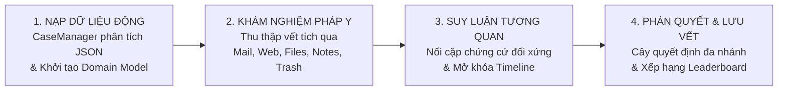
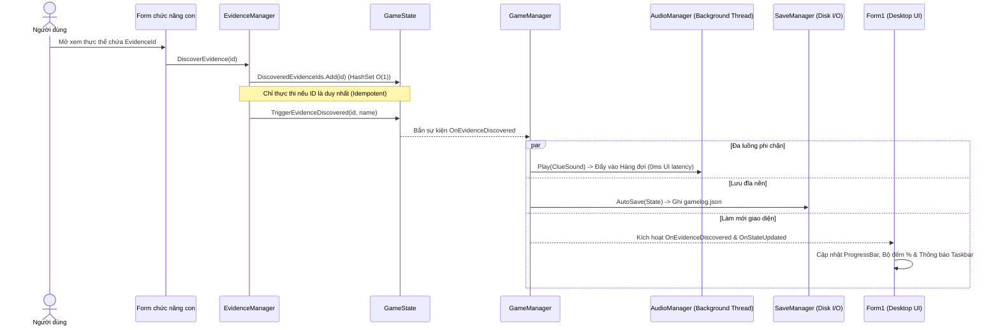
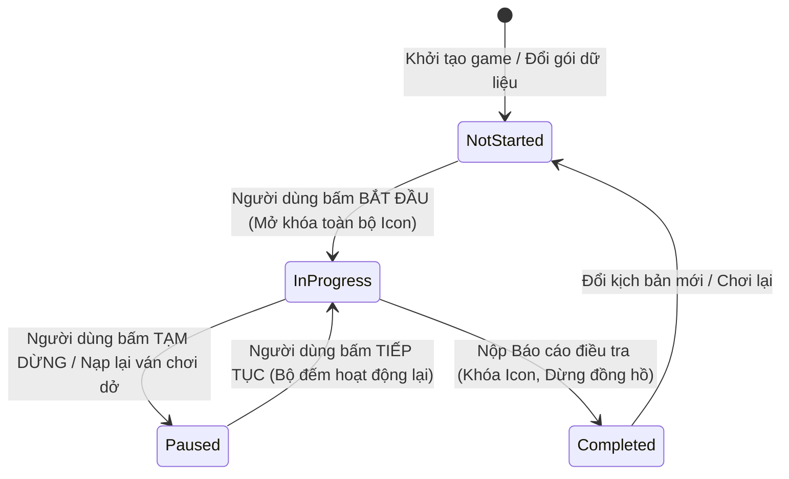
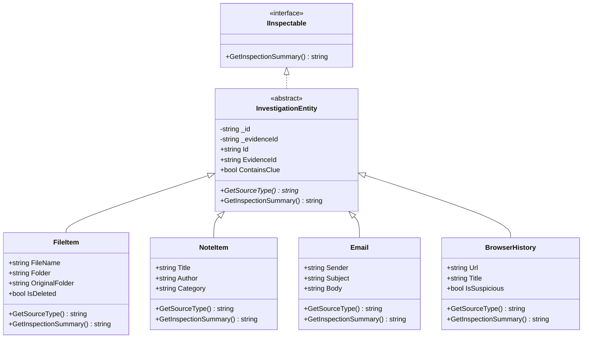
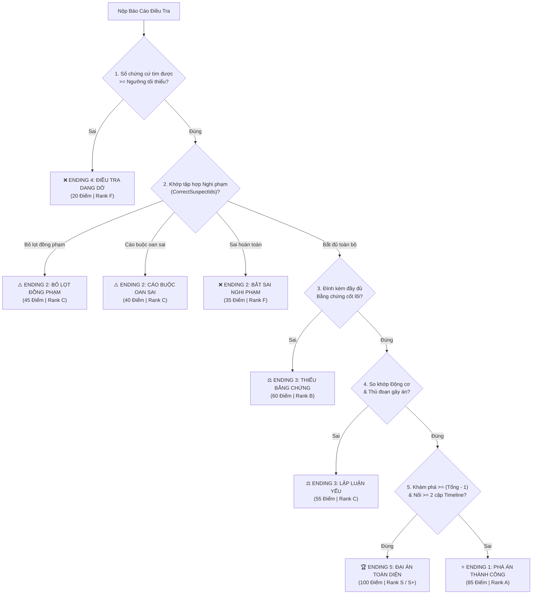

# TÀI LIỆU CẨM NANG KIẾN TRÚC, CƠ CHẾ VẬN HÀNH & THUẬT TOÁN HỆ THỐNG
## DESKTOP DETECTIVE — NỀN TẢNG MÔ PHỎNG ĐIỀU TRA KỸ THUẬT SỐ (C# .NET 10 WINFORMS)

> **Môn học:** Lập trình Windows  
> **Nền tảng & Công nghệ:** .NET 10.0 (`net10.0-windows`), C# 13, Windows Forms, System.Text.Json, NAudio 3.1.0  
> **Danh sách 4 thành viên & Vai trò cốt lõi:**  
> 1. **Hồ Minh Nhật** (`51.01.104.065`) — *Kiến trúc Hệ thống, Game Engine, Đa luồng & Thuật toán Nghiệp vụ (`Game/`, `Models/`)*  
> 2. **Trần Ngọc Hà** (`51.01.104.020`) — *Thiết kế Giao diện Hệ điều hành ảo, Responsive Layout Engine & 13 Biểu mẫu (`Form1.cs`, `Forms/`)*  
> 3. **Đào Khánh Trúc** (`51.01.104.109`) — *Mô hình Dữ liệu Động (100% Data-Driven JSON Schema), Thực thể Pháp y & Hệ thống Luật Suy luận (`Data/Cases/*.json`, `Models/`)*  
> 4. **Phan Thị Trang** (`51.01.104.102`) — *Kiểm thử Hộp đen/Hộp trắng, Bảng Vàng Thành tích (`HighScoreManager`), Xử lý Ngoại lệ I/O & Báo cáo (`SaveManager`)*

---

## MỤC LỤC TỔNG QUAN

1. **[PHẦN 1: TỔNG QUAN HỆ THỐNG & CHU TRÌNH ĐIỀU TRA](#phần-1-tổng-quan-hệ-thống--chu-trình-điều-tra)**
2. **[PHẦN 2: KIẾN TRÚC HỆ THỐNG & LUỒNG HOẠT ĐỘNG (4-LAYER ARCHITECTURE)](#phần-2-kiến-trúc-hệ-thống--luồng-hoạt-động-4-layer-architecture)**
3. **[PHẦN 3: CÔNG NGHỆ, MÔ HÌNH HƯỚNG ĐỐI TƯỢNG (OOP) & DESIGN PATTERNS](#phần-3-công-nghệ-mô-hình-hướng-đối-tượng-oop--design-patterns)**
4. **[PHẦN 4: GIẢI PHẪU CHI TIẾT CÁC THUẬT TOÁN CỐT LÕI (ALGORITHMS DEEP-DIVE)](#phần-4-giải-phẫu-chi-tiết-các-thuật-toán-cốt-lõi-algorithms-deep-dive)**
5. **[PHẦN 5: CẨM NANG CHUYÊN SÂU CHO TỪNG THÀNH VIÊN (4 ROLES PLAYBOOK)](#phần-5-cẩm-nang-chuyên-sâu-cho-từng-thành-viên-4-roles-playbook)**
6. **[PHẦN 6: BỘ CÂU HỎI & TRẢ LỜI VẤN ĐÁP BẢO VỆ ĐỀ TÀI](#phần-6-bộ-câu-hỏi--trả-lời-vấn-đáp-bảo-vệ-đề-tài)**

---

## PHẦN 1: TỔNG QUAN HỆ THỐNG & CHU TRÌNH ĐIỀU TRA

### 1.1. Ý tưởng & Cơ chế Hoạt động Cốt lõi
**Desktop Detective** biến giao diện Windows Forms thành một **Hệ điều hành ảo độc lập (Virtual OS Desktop Environment)** của đối tượng điều tra. Người dùng đóng vai trò chuyên viên giám định pháp y kỹ thuật số (Digital Forensics Investigator), tương tác với các ứng dụng mô phỏng trên màn hình để thu thập dấu vết điện tử, kết nối các mắt xích logic và khởi tố hồ sơ lên hội đồng xét xử.

Toàn bộ hệ thống được xây dựng theo **Kiến trúc Hướng dữ liệu Động (100% Dynamic Data-Driven Architecture)**: không có bất kỳ dữ liệu án văn hay ràng buộc kịch bản nào bị mã hóa cứng trong mã nguồn C#. Ứng dụng tự động điều chỉnh cấu trúc thư mục, giao diện phần mềm, trạng thái kết nối mạng và luật kết luận theo từng gói dữ liệu JSON đầu vào.

### 1.2. Chu trình Vòng đời Điều tra (Core Investigation Loop)



1. **Bước 1 — Nạp & Chuẩn hóa Dữ liệu (`CaseManager`):**  
   Hệ thống đọc gói dữ liệu vụ án (`CasePackage`), tự động chuẩn hóa các danh sách rỗng, suy diễn thư mục gốc, bảo toàn các mã bằng chứng chưa được khai báo, tự động đưa các manh mối không thuộc ứng dụng nào vào hệ thống tệp tin duyệt file dưới thư mục cha `Documents`, và thiết lập cây thư mục phân cấp ảo.
2. **Bước 2 — Khám Nghiệm Bằng chứng Bất biến (`EvidenceManager`):**  
   Khi người dùng tương tác với các thực thể điều tra (đọc email, kiểm tra lịch sử web, mở tệp tin, xem ghi chú), cơ chế khám nghiệm bất biến lặp (Idempotent Discovery) được kích hoạt: kiểm tra độ mới trong $O(1)$, phát sự kiện toàn cục, kích hoạt âm thanh phản hồi và ghi vết tự động xuống đĩa cứng (`gamelog.json`).
3. **Bước 3 — Suy Luận & Dựng Dòng Thời Gian (`TimelineManager`):**  
   Người dùng kết nối 2 bằng chứng trên bảng suy luận. Hệ thống chuẩn hóa khóa cặp đối xứng bất biến thứ tự, đối chiếu với tập luật logic hai chiều và mở khóa các mốc sự kiện thực tế trong dòng thời gian.
4. **Bước 4 — Đánh giá Hồ sơ & Phân nhánh Kết thúc (`CaseManager` + `HighScoreManager`):**  
   Báo cáo điều tra tổng hợp danh sách khởi tố (hỗ trợ đơn nghi phạm hoặc đa nghi phạm đồng lõa), lập luận động cơ, thủ đoạn và các vật chứng bắt buộc. Thuật toán Cây quyết định đa tầng phân tích hồ sơ và trả về 1 trong 5 kết cục độc lập (với các phân nhánh bỏ lọt đồng phạm hoặc cáo buộc oan sai), đồng thời ghi nhận kỷ lục vào tệp văn bản theo thuật toán sắp xếp đa tiêu chí.

---

## PHẦN 2: KIẾN TRÚC HỆ THỐNG & LUỒNG HOẠT ĐỘNG (4-LAYER ARCHITECTURE)

### 2.1. Mô hình Phân tầng 4 Lớp (4-Layer Architectural Pattern)

```
┌──────────────────────────────────────────────────────────────────────────────┐
│                    1. PRESENTATION LAYER (TẦNG GIAO DIỆN)                    │
│  • Form1.cs: Màn hình Desktop ảo, Thanh Taskbar, Đồng hồ, Quản lý Cửa sổ     │
│  • Nhóm Điều tra: ExplorerForm, BrowserForm, MailForm, RecycleBinForm, Notes │
│  • Nhóm Phá án:   EvidenceBoardForm, CaseReportForm, CaseSelectForm          │
│  • Nhóm Hệ thống: HighScoreForm, GuideForm, AboutForm, CreditsForm           │
└──────────────────────────────────────┬───────────────────────────────────────┘
                                       │ Giao tiếp qua Singleton & C# Events
                                       ▼
┌──────────────────────────────────────────────────────────────────────────────┐
│             2. BUSINESS LOGIC LAYER (TẦNG ĐIỀU PHỐI & LOGIC NGHIỆP VỤ)       │
│  • GameManager.cs:      Bộ điều phối trung tâm, Giám sát FileSystemWatcher    │
│  • CaseManager.cs:      Nạp gói dữ liệu động & Cây quyết định chấm điểm      │
│  • EvidenceManager.cs:  Bảng băm tra cứu O(1) & Mở khóa manh mối Idempotent   │
│  • TimelineManager.cs:  Đối sánh luật suy luận hai chiều & Mở khóa sự kiện   │
│  • AudioManager.cs:     Engine âm thanh đa luồng (Worker Thread + DSP Wave)  │
│  • SaveManager.cs:      Tuần tự hóa/Giải tuần tự hóa tiến trình (JSON I/O)   │
│  • HighScoreManager.cs: Phân tích cú pháp tệp TXT, Xếp hạng kỷ lục đa tiêu chí│
└──────────────────────────────────────┬───────────────────────────────────────┘
                                       │ Thao tác trên Thực thể nghiệp vụ
                                       ▼
┌──────────────────────────────────────────────────────────────────────────────┐
│                     3. DOMAIN & MODEL LAYER (TẦNG MÔ HÌNH DỮ LIỆU)           │
│  • IInspectable (Giao diện chuẩn hóa) ◄── InvestigationEntity (Lớp cơ sở)    │
│       ├── FileItem (Tệp tin hệ thống & Thùng rác)                            │
│       ├── Email (Thư điện tử truyền thông nội bộ)                            │
│       ├── BrowserHistory (Bản ghi truy cập web)                              │
│       └── NoteItem (Bản ghi chú & Giấy nhớ)                                  │
│  • Thực thể Logic: Evidence, Suspect, TimelineEntry, EvidenceConnectionRule │
│  • Trạng thái & Gói dữ liệu: GameState, CasePackage, InvestigationResult     │
└──────────────────────────────────────┬───────────────────────────────────────┘
                                       │ Lưu trữ / Khôi phục vật lý
                                       ▼
┌──────────────────────────────────────────────────────────────────────────────┐
│                  4. PERSISTENCE LAYER (TẦNG LƯU TRỮ VẬT LÝ)                  │
│  • Data/Cases/*.json : Gói cấu hình vụ án độc lập (JSON Schema)              │
│  • gamelog.json      : Bản ghi tiến trình thời gian thực (Auto-Save)         │
│  • savegame.json     : Bản sao lưu trạng thái thủ công                       │
│  • highscores.txt    : Bảng vàng thành tích định dạng khối khóa/giá trị      │
│  • Sounds/*.wav      : Luồng âm thanh kỹ thuật số                            │
└──────────────────────────────────────────────────────────────────────────────┘
```

### 2.2. Bản đồ Thư mục & Phân công Vai trò Từng File Mã nguồn

| Thư mục / Tệp tin | Vai trò Chức năng & Mối liên hệ Kiến trúc | Thành viên Phụ trách Chính |
|---|---|---|
| [`Program.cs`](file:///D:/Projects/ltw/2611_WIN_B3/Program.cs) | Điểm khởi chạy ứng dụng (`Main`), bật cấu hình DPI-Awareness PerMonitorV2 và kích hoạt `Form1`. | Hồ Minh Nhật |
| [`Form1.cs`](file:///D:/Projects/ltw/2611_WIN_B3/Form1.cs) | Màn hình Desktop OS ảo, quản lý vòng đời trạng thái FSM, layout thích ứng, điều phối mở 12 Form con và 8 ứng dụng Desktop. | Trần Ngọc Hà & Hồ Minh Nhật |
| [`Game/GameManager.cs`](file:///D:/Projects/ltw/2611_WIN_B3/Game/GameManager.cs) | **Trái tim điều phối hệ thống** (Singleton): quản lý `State`, `CaseManager`, `EvidenceManager`, `TimelineManager` và cơ chế phòng vệ kép. | Hồ Minh Nhật |
| [`Game/GameState.cs`](file:///D:/Projects/ltw/2611_WIN_B3/Game/GameState.cs) | Lưu trữ tiến trình phiên điều tra: các `HashSet<string>` lưu ID vết tích, tệp đã mở, tệp đã phục hồi, danh sách khởi tố đa nghi phạm và phát sự kiện. | Hồ Minh Nhật |
| [`Game/CaseManager.cs`](file:///D:/Projects/ltw/2611_WIN_B3/Game/CaseManager.cs) | Nạp động gói dữ liệu JSON, tự động đưa manh mối mồ côi vào duyệt file, chuẩn hóa cây thư mục, đồng bộ Thùng rác và Cây quyết định đa nhánh. | Hồ Minh Nhật & Đào Khánh Trúc |
| [`Game/EvidenceManager.cs`](file:///D:/Projects/ltw/2611_WIN_B3/Game/EvidenceManager.cs) | Quản lý bảng băm `Dictionary<string, Evidence>`, xử lý mở khóa manh mối bất biến lặp (`DiscoverEvidence`). | Hồ Minh Nhật |
| [`Game/TimelineManager.cs`](file:///D:/Projects/ltw/2611_WIN_B3/Game/TimelineManager.cs) | Đối sánh luật suy luận tương quan hai chiều (`TryConnectEvidences`) và trích xuất sự kiện Timeline đã xác thực. | Hồ Minh Nhật |
| [`Game/AudioManager.cs`](file:///D:/Projects/ltw/2611_WIN_B3/Game/AudioManager.cs) | Engine âm thanh đa luồng (`ConcurrentQueue` + `Thread`), bộ đệm lặp vô tận (`LoopStream`), tự tổng hợp sóng DSP Waveform. | Hồ Minh Nhật |
| [`Game/SaveManager.cs`](file:///D:/Projects/ltw/2611_WIN_B3/Game/SaveManager.cs) | Tuần tự hóa `GameState` ra tệp `gamelog.json` (tự động) và `savegame.json` (thủ công) bằng `System.Text.Json`. | Phan Thị Trang & Hồ Minh Nhật |
| [`Game/HighScoreManager.cs`](file:///D:/Projects/ltw/2611_WIN_B3/Game/HighScoreManager.cs) | Bộ phân tích cú pháp tệp `highscores.txt`, thuật toán phân loại Rank S+ đến F, sắp xếp bảng kỷ lục đa tiêu chí. | Phan Thị Trang |
| [`Models/InvestigationEntity.cs`](file:///D:/Projects/ltw/2611_WIN_B3/Models/InvestigationEntity.cs) | Giao diện `IInspectable` và lớp cơ sở trừu tượng `InvestigationEntity` (Trụ cột OOP của hệ thống). | Hồ Minh Nhật |
| [`Models/CaseData.cs`](file:///D:/Projects/ltw/2611_WIN_B3/Models/CaseData.cs) | Định nghĩa `FileItem`, `NoteItem`, `TimelineEntry`, `EvidenceConnectionRule`, `CasePackage`, hỗ trợ `CorrectSuspectIds`. | Đào Khánh Trúc & Hồ Minh Nhật |
| [`Models/Email.cs`](file:///D:/Projects/ltw/2611_WIN_B3/Models/Email.cs), [`BrowserHistory.cs`](file:///D:/Projects/ltw/2611_WIN_B3/Models/BrowserHistory.cs), [`Evidence.cs`](file:///D:/Projects/ltw/2611_WIN_B3/Models/Evidence.cs), [`Suspect.cs`](file:///D:/Projects/ltw/2611_WIN_B3/Models/Suspect.cs) | Các lớp thực thể dữ liệu nghiệp vụ với đóng gói toàn vẹn (`private fields` + `public properties`). | Đào Khánh Trúc & Hồ Minh Nhật |
| [`Forms/ExplorerForm.cs`](file:///D:/Projects/ltw/2611_WIN_B3/Forms/ExplorerForm.cs) & [`RecycleBinForm.cs`](file:///D:/Projects/ltw/2611_WIN_B3/Forms/RecycleBinForm.cs) | Quản lý tệp tin: Cây thư mục ảo hóa quy tụ dưới `Documents`, `ListView` 4 cột kèm thư mục con điều hướng nhấp đúp, phục hồi tệp tin Thùng rác hai chiều. | Trần Ngọc Hà |
| [`Forms/MailForm.cs`](file:///D:/Projects/ltw/2611_WIN_B3/Forms/MailForm.cs), [`BrowserForm.cs`](file:///D:/Projects/ltw/2611_WIN_B3/Forms/BrowserForm.cs), [`NotesForm.cs`](file:///D:/Projects/ltw/2611_WIN_B3/Forms/NotesForm.cs) | Ứng dụng điều tra: Hòm thư điện tử, Lịch sử duyệt web (`DataGridView` định dạng có điều kiện), Sổ tay cá nhân & Ghi chú Sticky Notes. | Trần Ngọc Hà |
| [`Forms/EvidenceBoardForm.cs`](file:///D:/Projects/ltw/2611_WIN_B3/Forms/EvidenceBoardForm.cs) & [`CaseReportForm.cs`](file:///D:/Projects/ltw/2611_WIN_B3/Forms/CaseReportForm.cs) | Bảng suy luận nối chứng cứ mở khóa Timeline và Biểu mẫu khởi tố đa nghi phạm (`CheckedListBox`), lựa chọn động cơ/thủ đoạn. | Trần Ngọc Hà |
| [`Forms/CaseSelectForm.cs`](file:///D:/Projects/ltw/2611_WIN_B3/Forms/CaseSelectForm.cs), [`HighScoreForm.cs`](file:///D:/Projects/ltw/2611_WIN_B3/Forms/HighScoreForm.cs), [`GuideForm.cs`](file:///D:/Projects/ltw/2611_WIN_B3/Forms/GuideForm.cs), [`AboutForm.cs`](file:///D:/Projects/ltw/2611_WIN_B3/Forms/AboutForm.cs), [`CreditsForm.cs`](file:///D:/Projects/ltw/2611_WIN_B3/Forms/CreditsForm.cs) | Biểu mẫu hệ thống: Chọn/Import gói vụ án JSON ngoài, Bảng vàng thành tích, Hướng dẫn nghiệp vụ, Thông tin đồ án. | Trần Ngọc Hà & Phan Thị Trang |
| `Data/Cases/*.json` | Các gói dữ liệu vụ án độc lập theo chuẩn JSON Schema, thể hiện cơ chế phân cấp độ khó, khóa tính năng và luật suy luận phong phú. | Đào Khánh Trúc |

### 2.3. Cơ chế Lan truyền Sự kiện Toàn cục (Event-Driven Flow)
Khi người dùng phát hiện manh mối tại bất kỳ cửa sổ con nào, giao diện không nắm giữ tham chiếu trực tiếp đến cửa sổ chính hay hệ thống lưu trữ (Loose Coupling):



### 2.4. Máy Trạng thái Vòng đời Trò chơi (Finite State Machine)
Tiến trình điều tra được quản lý thông qua máy trạng thái hữu hạn `InvestigationStatus` ([`GameState.cs`](file:///D:/Projects/ltw/2611_WIN_B3/Game/GameState.cs)):



---

## PHẦN 3: CÔNG NGHỆ, MÔ HÌNH HƯỚNG ĐỐI TƯỢNG (OOP) & DESIGN PATTERNS

### 3.1. Hiện thực 4 Trụ cột Lập trình Hướng đối tượng (OOP)



1. **Đóng gói (Encapsulation):** Mọi thực thể trong tầng Model đều sử dụng trường dữ liệu riêng tư (`private fields`) kết hợp thuộc tính truy cập (`public properties`). Việc gán giá trị được kiểm soát chặt chẽ: tự động loại bỏ khoảng trắng dư thừa (`.Trim()`), chuẩn hóa chữ hoa (`.ToUpperInvariant()`) và ném ngoại lệ khi vi phạm tính toàn vẹn dữ liệu.
2. **Kế thừa (Inheritance):** Lớp cơ sở trừu tượng `InvestigationEntity` đóng gói các thuộc tính nhận diện chung của vật chứng số (`Id`, `EvidenceId`, cờ nhận biết `ContainsClue`). 4 lớp thực thể đại diện cho các ứng dụng hệ thống gồm `FileItem`, `NoteItem`, `Email`, `BrowserHistory` cùng kế thừa trực tiếp từ lớp cơ sở này.
3. **Đa hình (Polymorphism):** Phương thức thuần ảo `abstract string GetSourceType()` và phương thức ảo `virtual string GetInspectionSummary()` được định nghĩa ở lớp cha. Từng lớp con ghi đè (`override`) để phản ánh nguồn gốc phù hợp: `FileItem` phản ánh linh hoạt giữa thư mục hệ thống hoặc Thùng rác dựa trên trạng thái `IsDeleted`; `Email` trả về định dạng hòm thư; `BrowserHistory` trả về bản ghi duyệt web.
4. **Trừu tượng (Abstraction):** Giao diện `IInspectable` quy định hợp đồng hành vi giám định cho mọi đối tượng. Toàn bộ cơ chế phức tạp bên dưới được che giấu sau giao diện chuẩn hóa.

### 3.2. Danh mục 6 Mẫu Thiết kế Phần mềm (Design Patterns)
* **Thread-Safe Singleton (`Lazy<T>`):** Triển khai tại `GameManager.Instance` và `AudioManager.Instance`. Đảm bảo tính duy nhất và an toàn luồng tuyệt đối trên toàn bộ vòng đời chương trình.
* **Observer Pattern (C# Events / Action Delegates):** `GameState` phát các sự kiện thay đổi (`OnEvidenceDiscovered`, `OnStateUpdated`, `OnNotification`). Các biểu mẫu giao diện đăng ký nhận tin để tự động cập nhật mà không gây phụ thuộc ngược (Decoupling).
* **Producer-Consumer Pattern (Đa luồng Phi chặn):** Trong `AudioManager`, luồng giao diện chính đóng vai trò Producer đẩy yêu cầu âm thanh vào hàng đợi luồng `ConcurrentQueue<Action>` (độ trễ 0ms). Luồng công nhân ngầm (Worker Thread) đóng vai trò Consumer chờ kích hoạt bởi `AutoResetEvent` để giải mã và phát âm thanh.
* **Repository Pattern:** `EvidenceManager` đóng gói kho dữ liệu `Dictionary<string, Evidence>`, cung cấp các phương thức truy vấn danh sách trì hoãn (Deferred Execution) thông qua từ khóa `yield return`.
* **Decorator / Wrapper Pattern:** Lớp `LoopStream` kế thừa `WaveStream` bọc quanh luồng đọc tệp âm thanh gốc để cung cấp khả năng phát lặp tuần hoàn không giới hạn mà không bị ngắt âm.
* **Data-Driven Architecture:** Tách rời hoàn toàn logic phần mềm và kịch bản nghiệp vụ. Gói dữ liệu JSON quy định toàn bộ danh sách nghi phạm, chứng cứ, liên kết logic và cả trạng thái cô lập ứng dụng.

---

## PHẦN 4: GIẢI PHẪU CHI TIẾT CÁC THUẬT TOÁN CỐT LÕI (ALGORITHMS DEEP-DIVE)

### Thuật toán 1: Cây Quyết định Chấm điểm Đa Tầng & Khởi tố Đa Nghi phạm (Decision Tree Evaluation)
* **Vị trí:** [`CaseManager.cs`](file:///D:/Projects/ltw/2611_WIN_B3/Game/CaseManager.cs) — Phương thức `EvaluateCase()`
* **Độ phức tạp:** Thời gian $O(M)$ (với $M$ là số bằng chứng cốt lõi); Không gian bộ nhớ $O(1)$.
* **Nguyên lý Đánh giá Đa Tầng:**



* **Logic Nhận diện Đa Nghi phạm (Accomplice & Co-conspirator Matching):**  
  Hệ thống hỗ trợ phân tích đa nghi phạm (phân tách danh sách dạng chuỗi `"ID_1, ID_2"` sang tập hợp `HashSet<string>`):
  * **Bắt đủ toàn bộ (`targetSet.SetEquals(accusedSet)`):** Vượt qua tầng thẩm định danh tính.
  * **Bỏ lọt đồng phạm (`targetSet.Overlaps(accusedSet) && !innocentAccused`):** Chỉ điểm đúng một phần hung thủ nhưng để sót đồng phạm nguy hiểm $\to$ Ending 2 (45 điểm).
  * **Cáo buộc oan sai (`targetSet.Overlaps(accusedSet) && innocentAccused`):** Khởi tố lẫn lộn giữa thủ phạm thật và người vô tội $\to$ Ending 2 (40 điểm).
  * **Bắt sai hoàn toàn (`!targetSet.Overlaps(accusedSet)`):** Bắt nhầm người hoàn toàn vô tội $\to$ Ending 2 (35 điểm).

### Thuật toán 2: So khớp Động cơ & Phương thức Kháng Sai số (Fuzzy/Normalized Reasoning Matching)
* **Vị trí:** [`CaseManager.cs`](file:///D:/Projects/ltw/2611_WIN_B3/Game/CaseManager.cs) — Phương thức `IsMotiveOrMethodMatch()`
* **Mục đích:** Khắc phục triệt để lỗi không khớp chuỗi do dấu câu cuối dòng (`.`, `;`, `,`), khoảng trắng thừa, hoặc sự chênh lệch diễn đạt giữa danh sách lựa chọn và cấu hình đáp án.
* **Nguyên lý:**
  1. Chuẩn hóa chuỗi văn bản (`NormalizeReasoningText`): Cắt tỉa khoảng trắng đầu cuối, loại bỏ toàn bộ dấu chấm câu ở cuối chuỗi (`TrimEnd('.', ';', '!', '?', ':', ',')`) và gộp các khoảng trắng liên tiếp về 1 khoảng trắng duy nhất qua biểu thức chính quy `\s+`.
  2. So khớp trực tiếp giữa chuỗi lựa chọn và mục tiêu đáp án.
  3. So khớp dung sai hai chiều (`Contains` lồng nhau): Cho phép nhận diện chính xác ngay cả khi cấu hình mở rộng có thêm phần phụ chú hoặc chi tiết bổ sung.

### Thuật toán 3: Chuẩn hóa Cây Thư mục Động & Điều hướng File Explorer
* **Vị trí:** [`ExplorerForm.cs`](file:///D:/Projects/ltw/2611_WIN_B3/Forms/ExplorerForm.cs) — `NormalizeToDocumentsPath()`, `InitFolderTree()`, `LoadFilesForFolder()`
* **Cơ chế Phân cấp Động:**
  1. **Chuẩn hóa Đường dẫn Gốc (`NormalizeToDocumentsPath`):** Bất kỳ đường dẫn nào (ngoại trừ Thùng rác `Recycle Bin`) đều được tự động đưa về dưới cây thư mục cha chuẩn mực: `"Work"` $\to$ `"Documents / Work"`.
  2. **Dựng Cây Phân cấp Đệ quy:** Thư mục gốc `Documents` đóng vai trò nút cha duy nhất dưới `This PC`. Toàn bộ các phân đoạn con được tách mảng và chèn đệ quy vào nhánh con của `Documents`.
  3. **Hiển thị Thư mục Con trong ListView 4 Cột & Điều hướng Chuột:**  
     Bảng danh sách hiển thị đầy đủ 4 cột (`colName`: Tên tệp/Thư mục, `colFolder`: Thư mục cha, `colSize`: Kích thước, `colModified`: Thời gian). Khi ở thư mục cha, các thư mục con tự động được đưa lên đầu danh sách (`📁 [Tên thư mục]`). Sự kiện nhấp đúp chuột (`DoubleClick`) trên hàng thư mục con sẽ tự động chuyển vị trí chọn trên `TreeView` và duyệt sâu vào thư mục đó.

### Thuật toán 4: Tự động Đưa Manh mối Mồ côi vào Duyệt File
* **Vị trí:** [`CaseManager.cs`](file:///D:/Projects/ltw/2611_WIN_B3/Game/CaseManager.cs) — Hàm `InitPackageDefaults()` & `DetermineFolderFromSource()`
* **Nguyên lý:**
  * Hệ thống quét toàn bộ danh sách `Evidences`. Nếu phát hiện bất kỳ mã bằng chứng nào chưa được gán vào Email, BrowserHistory, Notes hay Files ban đầu, hệ thống tự động khởi tạo một đối tượng `FileItem` (định danh `FILE_AUTO_{id}`) để đưa vào hệ thống duyệt tập tin của nạn nhân.
  * Thư mục lưu trữ của tệp tự động được chuẩn hóa về dưới cây thư mục cha `Documents` thông qua hàm `DetermineFolderFromSource`, đảm bảo người dùng luôn có thể tìm thấy toàn bộ dấu vết pháp y trực quan trong File Explorer.

### Thuật toán 5: Suy luận Tương quan Hai chiều & Chuẩn hóa Khóa Đối xứng (Canonical Symmetrical Pairing)
* **Vị trí:** [`TimelineManager.cs`](file:///D:/Projects/ltw/2611_WIN_B3/Game/TimelineManager.cs) — Phương thức `TryConnectEvidences()`
* **Giải pháp toán học:**
  * Khóa cặp bất biến thứ tự: Dù người dùng chọn nối $(A, B)$ hay $(B, A)$, hệ thống đều ánh xạ về một khóa chuẩn tắc duy nhất:
    $$\text{CanonicalKey} = \min(A, B) + \text{"+"} + \max(A, B)$$
  * Tra cứu đối xứng: Đối chiếu song song hai chiều trên tập luật:
    $$(r.EvidenceA == A \land r.EvidenceB == B) \lor (r.EvidenceA == B \land r.EvidenceB == A)$$
  * Ngăn ngừa trùng lặp tuyệt đối trong $O(1)$ thông qua việc lưu vết `CanonicalKey` vào tập hợp `HashSet<string>`.

### Thuật toán 6: Khám phá Manh mối Bất biến Lặp (Idempotent Evidence Discovery)
* **Vị trí:** [`EvidenceManager.cs`](file:///D:/Projects/ltw/2611_WIN_B3/Game/EvidenceManager.cs) — Phương thức `DiscoverEvidence(id)`
* **Nguyên lý:** Kết hợp bảng băm `Dictionary<string, Evidence>` và tập hợp băm `HashSet<string> DiscoveredEvidenceIds`:
  * Gọi trực tiếp `_state.DiscoveredEvidenceIds.Add(id)`: Phương thức `.Add()` của `HashSet<T>` trong nền tảng .NET thực hiện kiểm tra tồn tại và chèn mới đồng thời trong **$O(1)$**.
  * Chỉ khi phương thức trả về `true` (dấu hiệu chưa từng xuất hiện), hệ thống mới ghi nhận điểm, kích hoạt âm thanh và phát sự kiện cập nhật tiến trình. Mọi thao tác click lặp lại đều trả về `false` và bỏ qua ngay lập tức.

### Thuật toán 7: Cơ chế Phòng vệ Kép Giám sát Tệp Nhật ký (Dual-Defense File Liveness Trap)
* **Vị trí:** [`GameManager.cs`](file:///D:/Projects/ltw/2611_WIN_B3/Game/GameManager.cs) & [`Form1.cs`](file:///D:/Projects/ltw/2611_WIN_B3/Form1.cs)
* **Mục đích:** Phát hiện hành vi can thiệp trái phép hoặc xóa bỏ tệp lưu vết `gamelog.json` từ bên ngoài hệ điều hành khi ứng dụng đang chạy.
* **Cấu trúc Phòng thủ 2 Lớp:**
  * **Lớp 1 (Ngắt Hệ điều hành - `FileSystemWatcher`):** Bắt sự kiện ngắt `_fileWatcher.Deleted`. Khi phát hiện tệp bị xóa, hệ thống lập tức gọi `ResetGame(becauseFileDeleted: true)`.
  * **Lớp 2 (Thăm dò Định kỳ - `Polling Liveness Check`):** Dự phòng trường hợp tràn bộ đệm sự kiện (Buffer Overflow) của hệ điều hành, mỗi chu kỳ 1 giây của đồng hồ hệ thống (`systemTimer_Tick`), ứng dụng chủ động kiểm tra sự tồn tại vật lý của tệp. Nếu tệp biến mất trong khi tiến trình đang diễn ra, trạng thái trò chơi được hoàn nguyên về 0 ngay lập tức.

### Thuật toán 8: Xáo trộn Phương án Nhiễu Tất định theo Hạt giống (Deterministic Seeded Shuffle)
* **Vị trí:** [`CaseReportForm.cs`](file:///D:/Projects/ltw/2611_WIN_B3/Forms/CaseReportForm.cs)
* **Nguyên lý:** Khởi tạo bộ sinh số giả ngẫu nhiên `Random` dựa trên mã băm của định danh vụ án (`CaseId.GetHashCode()`):
  * Đảm bảo thứ tự các phương án lựa chọn trên ComboBox được đảo ngẫu nhiên (không để lộ đáp án đúng ở vị trí đầu tiên).
  * Đảm bảo tính tất định: thứ tự hiển thị không bị thay đổi lộn xộn giữa các lần đóng/mở lại biểu mẫu trong cùng một ván chơi.

### Thuật toán 9: Tổng hợp Sóng âm Kỹ thuật số PCM & Tạo File WAV Tự động (Procedural DSP Waveform Synthesis)
* **Vị trí:** [`AudioManager.cs`](file:///D:/Projects/ltw/2611_WIN_B3/Game/AudioManager.cs)
* **Nguyên lý Toán học DSP:**  
  Nếu thư mục tài nguyên âm thanh bị thiếu tệp `.wav`, hệ thống tự động tổng hợp mảng mẫu âm thanh nhị phân 16-bit PCM ở tần số $f_s = 44100\text{ Hz}$ theo công thức sóng hình sin kết hợp họa âm và hàm suy giảm mũ:
  $$y(t) = A \cdot \left[\sin(2\pi f t) + k \cdot \sin(4\pi f t)\right] \cdot e^{-t / \tau}$$
  Thuật toán tự động đóng gói cấu trúc nhị phân chuẩn **RIFF WAVE Header** (44 bytes) và ghi tệp trực tiếp xuống đĩa để phục vụ phát âm thanh tức thì.

### Thuật toán 10: Bố cục Giao diện Thích ứng Toán học (Responsive Mathematical Layout Engine)
* **Vị trí:** [`Form1.cs`](file:///D:/Projects/ltw/2611_WIN_B3/Form1.cs)
* **Nguyên lý:**
  * **Lưới Biểu tượng Desktop (Modulo Grid Layout):** Tự động xác định số cột dựa trên bề rộng màn hình. Vị trí tọa độ của biểu tượng thứ $i$ được tính giải tích:
    $$\text{Cột } c = i \bmod \text{cols}, \quad \text{Hàng } r = \lfloor i / \text{cols} \rfloor$$
    $$X_i = \text{startX} + c \times \text{stepX}, \quad Y_i = \text{startY} + r \times \text{stepY}$$
  * **Chuyển đổi Trạng thái Nút bấm (Button Stacking):** Tự động chuyển đổi giữa bố cục 1 hàng ngang (khi bề rộng khả dụng $\ge 580\text{px}$) sang bố cục 2 hàng phân tầng (khi bề rộng $< 580\text{px}$) nhằm triệt tiêu hoàn toàn hiện tượng tràn khung hoặc đè lấp văn bản.

### Thuật toán 11: Đồng bộ Trạng thái Phục hồi Thùng rác Hai chiều (Bi-directional Recycle Bin Synchronization)
* **Vị trí:** [`CaseManager.cs`](file:///D:/Projects/ltw/2611_WIN_B3/Game/CaseManager.cs) & [`RecycleBinForm.cs`](file:///D:/Projects/ltw/2611_WIN_B3/Forms/RecycleBinForm.cs)
* **Nguyên lý:**
  * Lưu vết trạng thái ban đầu của mọi tệp tin (`InitialIsDeleted`, `InitialFolder`).
  * Khi khôi phục tệp: Chuyển cờ `IsDeleted = false`, trả `Folder` về `OriginalFolder`, ghi nhận ID vào `GameState.RestoredFileIds` và phát sự kiện `OnStateUpdated` để `ExplorerForm` lập tức hiển thị lại tệp trên cây thư mục.
  * Khi nạp lại ván chơi hoặc Reset: Hàm `SyncFileStates` tái tạo chính xác vị trí của từng tệp tin dựa trên tập hợp ID đã phục hồi.

---

## PHẦN 5: CẨM NANG CHUYÊN SÂU CHO TỪNG THÀNH VIÊN (4 ROLES PLAYBOOK)

### 👤 THÀNH VIÊN 1: HỒ MINH NHẬT (`51.01.104.065`)
**Vai trò:** *Kiến trúc Hệ thống, Game Engine, Đa luồng & Thuật toán Nghiệp vụ*

#### 1. Các tệp mã nguồn phụ trách chính:
* [`Game/GameManager.cs`](file:///D:/Projects/ltw/2611_WIN_B3/Game/GameManager.cs), [`Game/GameState.cs`](file:///D:/Projects/ltw/2611_WIN_B3/Game/GameState.cs)
* [`Game/CaseManager.cs`](file:///D:/Projects/ltw/2611_WIN_B3/Game/CaseManager.cs), [`Game/EvidenceManager.cs`](file:///D:/Projects/ltw/2611_WIN_B3/Game/EvidenceManager.cs), [`Game/TimelineManager.cs`](file:///D:/Projects/ltw/2611_WIN_B3/Game/TimelineManager.cs)
* [`Game/AudioManager.cs`](file:///D:/Projects/ltw/2611_WIN_B3/Game/AudioManager.cs)
* [`Models/InvestigationEntity.cs`](file:///D:/Projects/ltw/2611_WIN_B3/Models/InvestigationEntity.cs)

#### 2. Trọng tâm kỹ thuật & Kiến trúc bảo vệ:
* **Kiến trúc Điều phối Trung tâm Singleton & Tiêm phụ thuộc (Dependency Injection):** Constructor của `GameManager` thiết lập trật tự nạp dữ liệu: khởi tạo `CaseManager`, giải tuần tự hóa trạng thái phiên chơi từ `gamelog.json`, sau đó tiêm `State` và dữ liệu gói vụ án vào `EvidenceManager` và `TimelineManager`.
* **Engine Âm thanh Đa luồng Phi chặn (Zero-Lag Audio Engine):** Áp dụng mô hình Producer-Consumer bằng cách đẩy lệnh phát âm thanh vào `ConcurrentQueue<Action>` từ UI Thread (tiêu tốn 0ms), trong khi `AudioEngine_WorkerThread` đảm nhận giải mã và phát âm qua NAudio. Cơ chế giải phóng tài nguyên triệt để trong `Shutdown()` đảm bảo tiến trình ứng dụng thoát hoàn toàn khi đóng cửa sổ.
* **Cây Quyết định Phán quyết 5 Kết thúc & Nhận diện Đa nghi phạm:** Triển khai thuật toán đánh giá đa tầng thẩm định danh tính, xử lý logic đồng phạm (`targetSet.SetEquals`, `targetSet.Overlaps`), đính kèm vật chứng bắt buộc và so khớp chuẩn hóa cho Động cơ / Thủ đoạn.

---

### 👤 THÀNH VIÊN 2: TRẦN NGỌC HÀ (`51.01.104.020`)
**Vai trò:** *Thiết kế Giao diện Hệ điều hành ảo (Virtual OS UI) & Bố trí 13 Biểu mẫu (Forms)*

#### 1. Các tệp mã nguồn phụ trách chính:
* [`Form1.cs`](file:///D:/Projects/ltw/2611_WIN_B3/Form1.cs) & `Form1.Designer.cs`
* Nhóm biểu mẫu chức năng: [`ExplorerForm.cs`](file:///D:/Projects/ltw/2611_WIN_B3/Forms/ExplorerForm.cs), [`RecycleBinForm.cs`](file:///D:/Projects/ltw/2611_WIN_B3/Forms/RecycleBinForm.cs), [`MailForm.cs`](file:///D:/Projects/ltw/2611_WIN_B3/Forms/MailForm.cs), [`BrowserForm.cs`](file:///D:/Projects/ltw/2611_WIN_B3/Forms/BrowserForm.cs), [`NotesForm.cs`](file:///D:/Projects/ltw/2611_WIN_B3/Forms/NotesForm.cs), [`EvidenceBoardForm.cs`](file:///D:/Projects/ltw/2611_WIN_B3/Forms/EvidenceBoardForm.cs), [`CaseReportForm.cs`](file:///D:/Projects/ltw/2611_WIN_B3/Forms/CaseReportForm.cs), [`CaseSelectForm.cs`](file:///D:/Projects/ltw/2611_WIN_B3/Forms/CaseSelectForm.cs), [`HighScoreForm.cs`](file:///D:/Projects/ltw/2611_WIN_B3/Forms/HighScoreForm.cs), [`GuideForm.cs`](file:///D:/Projects/ltw/2611_WIN_B3/Forms/GuideForm.cs), [`AboutForm.cs`](file:///D:/Projects/ltw/2611_WIN_B3/Forms/AboutForm.cs), [`CreditsForm.cs`](file:///D:/Projects/ltw/2611_WIN_B3/Forms/CreditsForm.cs).

#### 2. Trọng tâm kỹ thuật & Kiến trúc bảo vệ:
* **Bộ tính toán Bố cục Thích ứng (Responsive Layout Engine):** Tính giải tích tọa độ lưới biểu tượng Desktop thông qua phép chia lấy nguyên/lấy dư (`Modulo Grid`), cơ chế tự động chuyển đổi bố cục hàng nút bấm (`Button Stacking`) và co giãn khung mô tả linh hoạt trên màn hình độ phân giải cao PerMonitorV2.
* **Làm chủ các Điều khiển Nâng cao của Windows Forms:**
  * `TreeView` + `ListView` (trong `ExplorerForm`): Cây thư mục ảo hóa với gốc chuẩn mực `Documents`, `ListView` 4 cột hiển thị thư mục con trên danh sách và điều hướng nhấp đúp chuột. Thuộc tính `.Tag` lưu trực tiếp tham chiếu đối tượng dữ liệu.
  * `CheckedListBox` (trong `CaseReportForm`): Bọc đối tượng `SuspectCheckItem` và `EvidenceCheckItem` cho phép tích chọn đa nghi phạm và đính kèm danh sách vật chứng.
  * `DataGridView` (trong `BrowserForm`): Bảng dữ liệu lịch sử duyệt web có định dạng có điều kiện, tô màu nổi bật cảnh báo các liên kết bất thường.
  * `SplitContainer` (trong `NotesForm`): Giao diện chia đôi màn hình hỗ trợ đồng thời xem ghi chú hệ thống và soạn thảo sổ tay cá nhân.
* **Kỹ thuật Chống nhấp nháy (Anti-Flicker) & An toàn Đa luồng Giao diện:** Sử dụng Reflection để bật thuộc tính `DoubleBuffered = true` trên các Panel chính và sử dụng `InvokeRequired` / `BeginInvoke` khi nhận sự kiện từ Engine trò chơi.

---

### 👤 THÀNH VIÊN 3: ĐÀO KHÁNH TRÚC (`51.01.104.109`)
**Vai trò:** *Thiết kế Cấu trúc Dữ liệu Động (Data-Driven JSON Schema) & Hệ thống Luật Pháp y*

#### 1. Các tệp mã nguồn phụ trách chính:
* [`Models/CaseData.cs`](file:///D:/Projects/ltw/2611_WIN_B3/Models/CaseData.cs), [`Models/InvestigationEntity.cs`](file:///D:/Projects/ltw/2611_WIN_B3/Models/InvestigationEntity.cs)
* [`Models/Email.cs`](file:///D:/Projects/ltw/2611_WIN_B3/Models/Email.cs), [`Models/BrowserHistory.cs`](file:///D:/Projects/ltw/2611_WIN_B3/Models/BrowserHistory.cs), [`Models/Evidence.cs`](file:///D:/Projects/ltw/2611_WIN_B3/Models/Evidence.cs), [`Suspect.cs`](file:///D:/Projects/ltw/2611_WIN_B3/Models/Suspect.cs)
* Toàn bộ các gói cấu hình vụ án JSON trong thư mục `Data/Cases/`.

#### 2. Trọng tâm kỹ thuật & Kiến trúc bảo vệ:
* **Đặc tả Schema Gói Vụ Án (`CasePackage`) & Khóa Ngoại Logic:** Xây dựng cấu trúc dữ liệu JSON liên kết mọi thực thể thông qua khóa định danh `EvidenceId`: một Email, Tệp tin, Bản ghi duyệt web hay Ghi chú đều có thể mang mã bằng chứng liên kết tới kho `Evidences`. Hỗ trợ cấu hình đa nghi phạm qua `CorrectSuspectIds`.
* **Cơ chế Khôi phục Dữ liệu Thiếu & Suy diễn Thư mục Gốc (Auto-Healing Heuristics):** Thuật toán tự động sinh đối tượng `Evidence` dự phòng khi phát hiện mã bằng chứng chưa khai báo trong mảng chính; cơ chế Heuristic dự đoán thư mục gốc của tệp tin trong Thùng rác dựa trên phần mở rộng (`.enc`, `.pem`, `.ps1`, `.txt`) để chống lỗi `NullReferenceException`.
* **Cơ chế Cô lập Ứng dụng theo Kịch bản (`DisabledApps` & `AppLockReasons`):** Hỗ trợ cấu hình khóa phần mềm linh hoạt (mô phỏng sự cố mạng, môi trường cách ly ngoại tuyến Air-Gapped) được đọc và thực thi động hoàn toàn từ tệp JSON.

---

### 👤 THÀNH VIÊN 4: PHAN THỊ TRANG (`51.01.104.102`)
**Vai trò:** *Kiểm thử Phần mềm (QA/Testing), Quản lý Lưu trữ Bảng Vàng (`HighScoreManager`, `SaveManager`) & Báo cáo*

#### 1. Các tệp mã nguồn phụ trách chính:
* [`Game/HighScoreManager.cs`](file:///D:/Projects/ltw/2611_WIN_B3/Game/HighScoreManager.cs), [`Forms/HighScoreForm.cs`](file:///D:/Projects/ltw/2611_WIN_B3/Forms/HighScoreForm.cs), [`highscores.txt`](file:///D:/Projects/ltw/2611_WIN_B3/highscores.txt)
* [`Game/SaveManager.cs`](file:///D:/Projects/ltw/2611_WIN_B3/Game/SaveManager.cs), [`Forms/GuideForm.cs`](file:///D:/Projects/ltw/2611_WIN_B3/Forms/GuideForm.cs), [`Forms/AboutForm.cs`](file:///D:/Projects/ltw/2611_WIN_B3/Forms/AboutForm.cs), [`CreditsForm.cs`](file:///D:/Projects/ltw/2611_WIN_B3/Forms/CreditsForm.cs).

#### 2. Trọng tâm kỹ thuật & Kiến trúc bảo vệ:
* **Bộ Phân tích Cú pháp Tệp Tùy biến (Custom Text Parser) cho `highscores.txt`:** Cơ chế đọc tệp văn bản định dạng khối `[RECORD]`, tách chuỗi khóa/giá trị tại dấu hai chấm đầu tiên (`line.IndexOf(':')`), sử dụng các phương thức chuyển đổi an toàn `int.TryParse` và `DateTime.TryParse` để chống lỗi dừng chương trình khi tệp văn bản bị chỉnh sửa thủ công từ bên ngoài.
* **Thuật toán Sắp xếp Kỷ lục Đa Tiêu chí & Phân lớp Danh hiệu:** Sắp xếp danh sách kỷ lục theo chuỗi ưu tiên (Điểm số cao hơn $\to$ Thời gian ít hơn $\to$ Thời điểm gần nhất) và phân loại danh hiệu thám tử đa ngưỡng (Rank S+, S, A, B, C, F) kết hợp giữa điểm số và thời gian phá án.
* **Cơ chế Kiểm thử Phần mềm & Giám sát Tệp Nhật ký (Testing & Defense Trap):** Thiết kế bộ kịch bản kiểm thử thẩm định 5 kết thúc của Cây quyết định; kiểm thử kiểm chứng cơ chế phòng vệ kép (xóa nóng tệp `gamelog.json` để xác nhận khả năng tự động hoàn nguyên của `FileSystemWatcher`).

---

## PHẦN 6: BỘ CÂU HỎI & TRẢ LỜI VẤN ĐÁP BẢO VỆ ĐỀ TÀI

| STT | Câu hỏi Trọng tâm | Câu trả lời Chuẩn mực Kỹ thuật |
|:---:|---|---|
| **1** | **Tính Kế thừa và Đa hình trong dự án được tổ chức như thế nào?** | Trong [`Models/InvestigationEntity.cs`](file:///D:/Projects/ltw/2611_WIN_B3/Models/InvestigationEntity.cs), giao diện `IInspectable` quy định hành vi `GetInspectionSummary()`, lớp trừu tượng `InvestigationEntity` đóng gói các trường dùng chung và phương thức thuần ảo `abstract string GetSourceType()`. 4 lớp thực thể con `FileItem`, `NoteItem`, `Email`, `BrowserHistory` cùng kế thừa và ghi đè phương thức này để phản ánh nguồn gốc đặc thù của từng loại bằng chứng. |
| **2** | **Làm thế nào để các Form con giao tiếp về Desktop mà không gây phụ thuộc chặt (Tight Coupling)?** | Ứng dụng áp dụng **Observer Pattern** kết hợp **Singleton Pattern**. Các Form chức năng con chỉ gửi lệnh `DiscoverEvidence(id)` tới `GameManager.Instance.EvidenceManager`. `GameState` sau đó kích hoạt các sự kiện C# `Action`. Cửa sổ chính `Form1` đăng ký lắng nghe sự kiện này để tự động cập nhật thanh tiến trình và thông báo Taskbar mà không cần Form con lưu trữ tham chiếu ngược. |
| **3** | **Làm sao để hệ thống nạp thêm một màn chơi/vụ án mới mà không cần biên dịch lại mã nguồn C#?** | Nhờ **Kiến trúc Hướng dữ liệu 100% (Data-Driven)**, toàn bộ thực thể, danh sách nghi phạm, chứng cứ, luật kết nối và cả cấu hình khóa ứng dụng (`DisabledApps`) đều nằm trong tệp JSON. Khi người dùng nạp tệp JSON mới qua `CaseSelectForm`, lớp `CaseManager` tự động phân tích cú pháp, chuẩn hóa thực thể và khởi tạo phiên chơi mà không cần chỉnh sửa một dòng code C# nào. |
| **4** | **Cơ chế khóa ứng dụng theo kịch bản (mất kết nối mạng, môi trường cách ly) vận hành ra sao?** | Khi nạp gói dữ liệu, `CasePackage` đọc mảng `"DisabledApps"` kèm thông điệp giải thích `"AppLockReasons"`. Cửa sổ `Form1` duyệt qua cấu hình này trong `UpdateAppIconVisualState()` để chuyển nhãn icon thành trạng thái khóa `🔒 (Offline)` và chặn mở cửa sổ trong `CheckAppAccessible()`, buộc người dùng phải điều tra qua các kênh thay thế. |
| **5** | **Thuật toán Cây quyết định đánh giá hồ sơ điều tra hoạt động theo nguyên lý nào?** | Phương thức `EvaluateCase()` trong [`CaseManager.cs`](file:///D:/Projects/ltw/2611_WIN_B3/Game/CaseManager.cs) thẩm định tuần tự qua 5 tầng lọc: (1) Ngưỡng số lượng bằng chứng tối thiểu $\to$ *Ending 4 (20đ)*; (2) Nhận diện tập hợp nghi phạm: bắt đủ đồng phạm, bỏ lọt đồng phạm (45đ), vu oan người vô tội (40đ) hoặc bắt sai hoàn toàn $\to$ *Ending 2 (35đ)*; (3) Thiếu bằng chứng cốt lõi $\to$ *Ending 3 (60đ)*; (4) Sai động cơ hoặc thủ đoạn $\to$ *Ending 3 (55đ)*; (5) Đúng toàn bộ kèm điều kiện mở rộng ($\ge \text{Total}-1$ chứng cứ và $\ge 2$ cặp kết nối) $\to$ *Ending 5 Đại án (100đ)*, ngược lại đạt *Ending 1 Chuẩn (85đ)*. |
| **6** | **Làm thế nào để đảm bảo người dùng click liên tục vào cùng một manh mối không bị tính điểm trùng lặp?** | Thuật toán khám nghiệm bất biến lặp (Idempotent Discovery) sử dụng tập hợp băm `HashSet<string> DiscoveredEvidenceIds`. Hàm `.Add(id)` có độ phức tạp $O(1)$ và chỉ trả về `true` khi phần tử chưa từng tồn tại trong tập hợp. Mọi thao tác click lặp lại đều trả về `false` và bị hệ thống bỏ qua ngay lập tức. |
| **7** | **Nếu tệp nhật ký `gamelog.json` bị người dùng xóa từ Windows Explorer trong lúc đang chơi thì sao?** | Hệ thống áp dụng **Cơ chế Phòng vệ Kép**: Lớp 1 dùng `FileSystemWatcher` bắt sự kiện xóa tệp từ hệ điều hành; Lớp 2 dùng thăm dò nhịp tim định kỳ (`Polling Liveness Check`) mỗi giây trong đồng hồ hệ thống. Ngay khi phát hiện tệp bị xóa, trò chơi lập tức hoàn nguyên toàn bộ trạng thái về 0 và thông báo cảnh báo trên giao diện. |
| **8** | **Tại sao việc phát âm thanh hiệu ứng liên tục không gây giật lag hay treo giao diện WinForms?** | Lớp `AudioManager` áp dụng mô hình **Producer-Consumer**: Luồng giao diện chính (UI Thread) chỉ đẩy yêu cầu phát âm thanh vào hàng đợi luồng `ConcurrentQueue<Action>` (tiêu tốn 0ms). Luồng công nhân ngầm (`AudioEngine_WorkerThread`) chịu trách nhiệm lấy yêu cầu ra giải mã và tương tác với phần cứng âm thanh thông qua NAudio độc lập hoàn toàn với luồng vẽ giao diện. |
| **9** | **Nếu máy tính kiểm tra bị thiếu toàn bộ các tệp âm thanh `.wav` thì ứng dụng có bị lỗi crash không?** | Hệ thống được trang bị thuật toán **Tổng hợp sóng âm số PCM (DSP Synthesis)**: tự động tính toán hàm lượng giác $\sin(2\pi f t) \cdot e^{-t/\tau}$, đóng gói cấu trúc nhị phân RIFF WAVE Header chuẩn 44.1kHz 16-bit và tạo mới tệp `.wav` thay thế tức thì, đồng thời có cơ chế phòng vệ thứ cấp chuyển đổi về `SystemSounds` của Windows. |
| **10** | **Tại sao khi mở lại ván chơi dở từ tệp lưu vết, đồng hồ không chạy tiếp ngay mà lại ở trạng thái Tạm dừng (`Paused`)?** | Trong [`GameManager.cs`](file:///D:/Projects/ltw/2611_WIN_B3/Game/GameManager.cs), khi khôi phục tiến trình từ `gamelog.json`, nếu trạng thái trước đó là `InProgress`, hệ thống chủ động chuyển sang `Paused`. Điều này giúp người dùng có thời gian quan sát lại hồ sơ điều tra trước khi chủ động bấm tiếp tục, bảo đảm tính công bằng tuyệt đối cho chỉ số thời gian phá án khi xếp hạng trên Bảng vàng. |

---
*Tài liệu kỹ thuật được chuẩn hóa đồng bộ với kiến trúc mã nguồn thực tế của dự án **Desktop Detective (`2611_WIN_B3`)** — Tập trung thuần túy vào Nền tảng Công nghệ, Cơ chế Vận hành, Mô hình OOP và Thuật toán Nghiệp vụ.*

