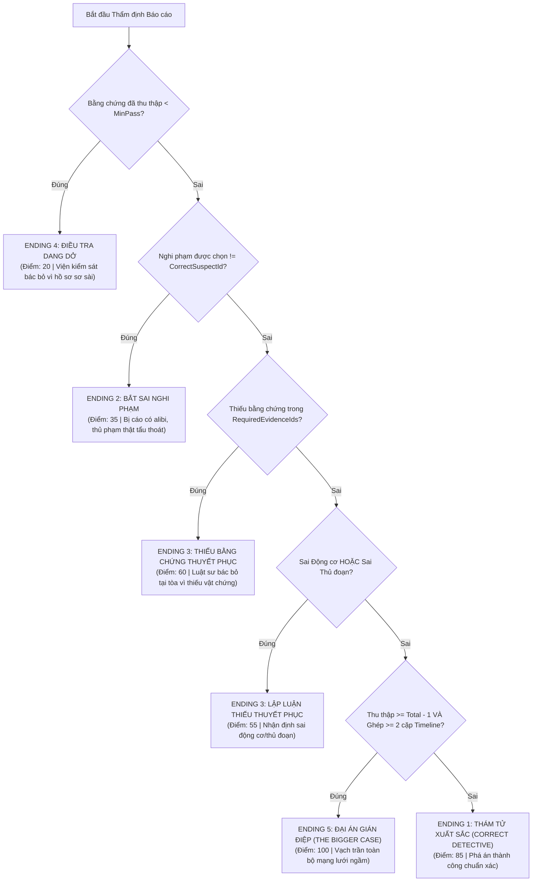

# TÀI LIỆU TOÀN DIỆN VỀ KIẾN TRÚC, THUẬT TOÁN VÀ KỸ THUẬT DỰ ÁN
## DESKTOP DETECTIVE — TRÒ CHƠI TRINH THÁM KỸ THUẬT SỐ (C# .NET WINFORMS)

> **Môn học:** Lập trình Windows  
> **Nền tảng:** .NET 10.0 (`net10.0-windows`), C# 13, Windows Forms  
> **Thư viện bên thứ ba:** NAudio 3.1.0 (Xử lý âm thanh đa luồng)  
> **Nhóm thực hiện:**  
> 1. Hồ Minh Nhật — MSSV: 51.01.104.065 (Lập trình chính & Kiến trúc hệ thống)  
> 2. Trần Ngọc Hà — MSSV: 51.01.104.020 (Thiết kế giao diện WinForms)  
> 3. Đào Khánh Trúc — MSSV: 51.01.104.109 (Nội dung & Dữ liệu vụ án)  
> 4. Phan Thị Trang — MSSV: 51.01.104.102 (Kiểm thử & Biên soạn tài liệu)  

---

## MỤC LỤC TRA CỨU NHANH (QUICK NAVIGATION INDEX)

| STT | Nội dung | Xem nhanh |
|:---:|---|---|
| **I** | **Tổng quan & Bối cảnh Đề tài** | [Xem Phần I](#i-tổng-quan--bối-cảnh-đề-tài) |
| **II** | **Kiến trúc Tổng thể Dự án (Architecture)** | [Xem Phần II](#ii-kiến-trúc-tổng-thể-dự-án-architecture) |
| 1 | Sơ đồ Phân tầng (Layered Architecture) | [Xem mục II.1](#1-kiến-trúc-phân-tầng-layered-architecture) |
| 2 | Sơ đồ Luồng Dữ liệu & Sự kiện (EDA & Data Flow) | [Xem mục II.2](#2-mô-hình-sự-kiện-event-driven-architecture) |
| 3 | Máy trạng thái Vòng đời Phá án (State Machine) | [Xem mục II.3](#3-máy-trạng-thái-điều-tra-investigation-state-machine) |
| 4 | Cấu trúc Thư mục & Bản đồ File Mã nguồn | [Xem mục II.4](#4-cấu-trúc-thư-mục--bản-đồ-tập-tin) |
| **III** | **Toàn bộ Các Thuật toán (Algorithms)** | [Xem Phần III](#iii-toàn-bộ-các-thuật-toán-trong-dự-án) |
| 1 | Thuật toán Cây Quyết định Phân nhánh 5 Kết thúc | [Xem mục III.1](#1-thuật-toán-đánh-giá-kết-quả-điều-tra--phân-nhánh-5-kết-thúc) |
| 2 | Thuật toán Suy luận Luật Tương quan Manh mối Hai chiều | [Xem mục III.2](#2-thuật-toán-suy-luận-luật-tương-quan-hai-chiều-bidirectional-inference) |
| 3 | Thuật toán Xếp hạng Bảng Vàng Đa tiêu chí | [Xem mục III.3](#3-thuật-toán-xếp-hạng-bảng-vàng-đa-tiêu-chí-multi-criteria-sorting) |
| 4 | Thuật toán Đánh giá Rank Thám tử (S+, S, A, B, C, F) | [Xem mục III.4](#4-thuật-toán-tính-xếp-hạng-thành-tích-rank-calculation) |
| 5 | Thuật toán Xáo trộn Ngẫu nhiên Có Hạt giống (Seeded Shuffle) | [Xem mục III.5](#5-thuật-toán-xáo-trộn-ngẫu-nhiên-có-hạt-giống-deterministic-shuffle) |
| 6 | Thuật toán Tìm kiếm Tập tin Toàn văn (Full-Text Search) | [Xem mục III.6](#6-thuật-toán-tìm-kiếm-tập-tin-toàn-văn-full-text-substring-search) |
| 7 | Thuật toán Thăm dò Thư mục Đa tầng (Multi-Path Directory Probe) | [Xem mục III.7](#7-thuật-toán-thăm-dò-đường-dẫn-đa-tầng-multi-path-directory-probe) |
| 8 | Thuật toán Đồng bộ & Ánh xạ Phục hồi Tập tin | [Xem mục III.8](#8-thuật-toán-đồng-bộ--ánh-xạ-phục-hồi-tập-tin-state-synchronization) |
| 9 | Thuật toán Vòng lặp Âm thanh Vô tận (Infinite Audio Loop) | [Xem mục III.9](#9-thuật-toán-lặp-âm-thanh-vô-tận-trên-luồng-dữ-liệu-loopstream) |
| 10 | Thuật toán Phòng vệ Kép Bắt Sự kiện Xóa Tệp OS | [Xem mục III.10](#10-thuật-toán-phòng-vệ-kép-bắt-sự-kiện-xóa-tệp-dual-defense-trap) |
| **IV** | **Toàn bộ Các Kỹ thuật Lập trình (Techniques)** | [Xem Phần IV](#iv-toàn-bộ-các-kỹ-thuật-lập-trình-áp-dụng) |
| 1 | Lập trình Hướng đối tượng Nâng cao (OOP) | [Xem mục IV.1](#1-lập-trình-hướng-đối-tượng-oop-nâng-cao) |
| 2 | Các Mẫu Thiết kế Áp dụng (Design Patterns) | [Xem mục IV.2](#2-các-mẫu-thiết-kế-design-patterns) |
| 3 | Kỹ thuật Đa luồng & Bất đồng bộ (Multithreading) | [Xem mục IV.3](#3-kỹ-thuật-đa-luồng-multithreading--concurrency) |
| 4 | Kỹ thuật Xử lý I/O, JSON & Tập tin Văn bản | [Xem mục IV.4](#4-kỹ-thuật-xử-lý-io-tuần-tự-hóa-json--tập-tin-văn-bản) |
| 5 | Kỹ thuật Giao diện Windows Forms Đồ họa Chuyên sâu | [Xem mục IV.5](#5-kỹ-thuật-giao-diện-windows-forms-chuyên-sâu) |
| **V** | **Bảng Tra cứu Nhanh Hỏi - Đáp Bảo vệ Đề tài** | [Xem Phần V](#v-bảng-tra-cứu-nhanh-hỏi--đáp-bảo-vệ-đề-tài) |

---

## I. TỔNG QUAN & BỐI CẢNH ĐỀ TÀI

**Desktop Detective** là ứng dụng game mô phỏng trinh thám kỹ thuật số (Digital Forensics Simulation) chạy trên nền tảng **.NET 10 Windows Forms**. Trò chơi biến màn hình máy tính của người chơi thành một chiếc máy tính ảo (Virtual Desktop OS) của nạn nhân trong vụ án.

Người chơi đóng vai thám tử công nghệ, sử dụng 9 ứng dụng chức năng được tích hợp trên màn hình để:
1. **Mail Client (`MailForm`):** Soi xét email nội bộ, tìm kiếm email gửi bất thường, thư đe dọa, thư hẹn gặp mờ ám.
2. **Web Browser (`BrowserForm`):** Rà soát lịch sử duyệt web để tìm đường link upload dữ liệu lậu, dịch vụ Cloud bí mật, cổng VPN.
3. **File Explorer (`ExplorerForm`):** Duyệt cây thư mục phân cấp (`TreeView`), đọc tài liệu dự án, mã nguồn, log máy chủ và biên bản cuộc họp.
4. **Recycle Bin (`RecycleBinForm`):** Phát hiện các tập tin bị thủ phạm xóa phi tang, khôi phục tập tin về thư mục gốc để mở khóa manh mối.
5. **Search Engine:** Tra cứu nhanh tập tin và nội dung nhật ký hệ thống bằng từ khóa.
6. **Detective Notes (`NotesForm`):** Sổ tay ghi chép thời gian thực, tự động lưu vào tệp tiến trình.
7. **Evidence Board (`EvidenceBoardForm`):** Bảng phân tích manh mối, nối cặp 2 bằng chứng để mở khóa các mốc Dòng thời gian vụ án (Timeline).
8. **Case Report (`CaseReportForm`):** Tòa án kết luận: Chọn nghi phạm, chọn động cơ, chọn thủ đoạn và tích chọn các bằng chứng cốt lõi để nhận 1 trong 5 kết thúc (Endings).
9. **Case Select (`CaseSelectForm`):** Đổi sang các vụ án khác (Hỗ trợ nạp gói vụ án mới động qua file JSON).

---

## II. KIẾN TRÚC TỔNG THỂ DỰ ÁN (ARCHITECTURE)

### 1. Kiến trúc Phân tầng (Layered Architecture)

Hệ thống được thiết kế theo mô hình 4 tầng phân lập rõ ràng, tuân thủ nguyên lý tách biệt mối quan tâm (Separation of Concerns):

```
┌────────────────────────────────────────────────────────────────────────┐
│                   PRESENTATION LAYER (TẦNG GIAO DIỆN)                  │
│  Form1 (Virtual Desktop OS, Taskbar, App Launchers, Status Control)    │
│  ExplorerForm | BrowserForm | MailForm | RecycleBinForm | NotesForm    │
│  EvidenceBoardForm | CaseReportForm | CaseSelectForm | HighScoreForm   │
│  GuideForm | AboutForm | CreditsForm                                  │
└───────────────────────────────────┬────────────────────────────────────┘
                                    │ (Gọi nghiệp vụ / Đăng ký sự kiện)
                                    ▼
┌────────────────────────────────────────────────────────────────────────┐
│             BUSINESS LOGIC & COORDINATION LAYER (TẦNG NGHIỆP VỤ)       │
│  GameManager (Singleton Coordinator - Điều phối toàn bộ vòng đời)      │
│  ├── EvidenceManager (Quản lý kho manh mối & Idempotent Discovery)     │
│  ├── TimelineManager (Inference Engine & Ghép nối sự kiện)             │
│  ├── CaseManager (Dynamic Case Loader & Decision Tree Evaluator)       │
│  ├── AudioManager (Dedicated Worker Thread Audio Engine, NAudio)       │
│  └── HighScoreManager (Multi-criteria Scoring Engine & TXT Parser)     │
└───────────────────────────────────┬────────────────────────────────────┘
                                    │ (Truy xuất & Thao tác)
                                    ▼
┌────────────────────────────────────────────────────────────────────────┐
│                     DOMAIN & MODEL LAYER (TẦNG DỮ LIỆU)                │
│  IInspectable (Interface) ◄── InvestigationEntity (Abstract Base Class)│
│       ├── FileItem                                                     │
│       ├── Email                                                        │
│       └── BrowserHistory                                               │
│  Evidence | Suspect | TimelineEntry | EvidenceConnectionRule           │
│  GameState | CasePackage | CaseData | HighScoreEntry                   │
└───────────────────────────────────┬────────────────────────────────────┘
                                    │ (Tuần tự hóa / Đọc ghi)
                                    ▼
┌────────────────────────────────────────────────────────────────────────┐
│              PERSISTENCE & STORAGE LAYER (TẦNG LƯU TRỮ VẬT LÝ)         │
│  Data/Cases/*.json (Gói vụ án: case_001.json, case_002.json, ...)      │
│  gamelog.json (File lưu tự động & bị giám sát bởi FileSystemWatcher)   │
│  savegame.json (File lưu trạng thái thủ công)                          │
│  highscores.txt (Bảng vàng thành tích dạng text đồng bộ 2 chiều)       │
└────────────────────────────────────────────────────────────────────────┘
```

---

### 2. Mô hình Sự kiện (Event-Driven Architecture)

Dự án áp dụng mô hình **Observer Pattern** thông qua C# Events để phân tách hoàn toàn tầng nghiệp vụ và tầng giao diện:

```
[Hành động người chơi] (Click Email / Xem Lịch sử Web / Khôi phục File)
                           │
                           ▼
            EvidenceManager.DiscoverEvidence(id)
                           │
                 (Kiểm tra Idempotent)
                           ▼
         GameState.TriggerEvidenceDiscovered(id, name)
         GameState.Notify(notificationMessage)
                           │
        ┌──────────────────┴──────────────────┐
        ▼                                     ▼
[OnEvidenceDiscovered Event]          [OnNotification Event]
        │                                     │
        ├─► AudioManager.Play(Clue)           ├─► AudioManager.Play(Notify)
        ├─► SaveManager.AutoSave()            ├─► SaveManager.AutoSave()
        ├─► Form1.UpdateDashboard()           └─► Form1.lblNotification
        └─► Form1.pbEvidenceProgress
```

---

### 3. Máy Trạng thái Điều tra (Investigation State Machine)

Quá trình phá án được kiểm soát chặt chẽ thông qua Enum `InvestigationStatus`:

```
               [Khởi động / Reset Game]
                           │
                           ▼
                  ┌─────────────────┐
                  │   NotStarted    │ ◄── Tất cả App bị vô hiệu hóa (Cursors.No)
                  └────────┬────────┘     Đồng hồ đứng yên ở 00:00
                           │
                  [Bấm nút "▶ BẮT ĐẦU"]
                           │
                           ▼
                  ┌─────────────────┐
                  │   InProgress    │ ◄── Kích hoạt tất cả App (Cursors.Hand)
                  └──────┬───▲──────┘     systemTimer đếm từng giây (ElapsedSeconds++)
     [Bấm "Tạm dừng"]    │   │   [Bấm "Tiếp tục"]
                         ▼   │
                  ┌──────────┴──────┐
                  │     Paused      │ ◄── Khóa tạm thời các App
                  └─────────────────┘     Đồng hồ dừng đếm (Bảo đảm công tâm)
                           │
                  [Nộp Case Report]
                           │
                           ▼
                  ┌─────────────────┐
                  │    Completed    │ ◄── Ngừng đồng hồ, ghi HighScore
                  └─────────────────┘     Hiển thị kết quả & Đánh giá Rank
```

---

### 4. Cấu trúc Thư mục & Bản đồ Tập tin

```
D:\ltw\2611_WIN_B3\
├── Data\
│   └── Cases\
│       ├── case_001.json           # Vụ án 1: The Missing File (Trộm tài sản trí tuệ)
│       ├── case_002.json           # Vụ án 2: The Ransomware Attack (Mã độc tống tiền)
│       └── case_003.json           # Vụ án 3: The Ghost in the System (Rò rỉ AI Model)
├── Forms\
│   ├── AboutForm.cs                # Giới thiệu đề tài, nhóm sinh viên & vụ án
│   ├── BrowserForm.cs              # Ứng dụng trình duyệt web ảo (DataGridView)
│   ├── CaseReportForm.cs           # Nộp báo cáo điều tra & kết luận vụ án
│   ├── CaseSelectForm.cs           # Quản lý danh sách vụ án & Nhập file JSON mới
│   ├── CreditsForm.cs              # Bảng phân công công việc & thành viên
│   ├── EvidenceBoardForm.cs        # Bảng suy luận manh mối & Timeline
│   ├── ExplorerForm.cs             # Ứng dụng quản lý tệp tin (TreeView & ListView)
│   ├── GuideForm.cs                # Cẩm nang hướng dẫn điều tra 4 chương (TabControl)
│   ├── HighScoreForm.cs            # Bảng thành tích & bộ lọc vụ án
│   ├── MailForm.cs                 # Ứng dụng hộp thư nội bộ ảo
│   ├── NotesForm.cs                # Sổ tay thám tử cá nhân
│   └── RecycleBinForm.cs           # Thùng rác ảo & cơ chế phục hồi tệp
├── Game\
│   ├── AudioManager.cs             # Audio Engine chạy nền, NAudio, non-blocking
│   ├── CaseManager.cs              # Nạp vụ án động & Đánh giá Cây Quyết định 5 Ending
│   ├── EvidenceManager.cs          # Kho lưu trữ bằng chứng & Idempotent Discovery
│   ├── GameManager.cs              # Singleton trung tâm, FileWatcher, Điều phối
│   ├── GameState.cs                # Đối tượng trạng thái điều tra (State DTO)
│   ├── HighScoreManager.cs         # Đọc/ghi highscores.txt, sắp xếp & xếp rank
│   ├── SaveManager.cs              # Tuần tự hóa JSON (gamelog.json, savegame.json)
│   └── TimelineManager.cs          # Tập luật suy luận hai chiều & Trục thời gian
├── Models\
│   ├── BrowserHistory.cs           # Thực thể lịch sử duyệt web
│   ├── CaseData.cs                 # Cấu hình CasePackage, FileItem, TimelineEntry
│   ├── Email.cs                    # Thực thể thư điện tử
│   ├── Evidence.cs                 # Thực thể bằng chứng/manh mối
│   ├── InvestigationEntity.cs      # Lớp cơ sở trừu tượng & Interface IInspectable
│   └── Suspect.cs                  # Thực thể hồ sơ nghi phạm
├── Sounds\
│   ├── bgm.mp3                     # Nhạc nền bí ẩn
│   ├── click.wav                   # Âm thanh click chuột
│   ├── clue.wav                    # Âm thanh phát hiện manh mối (Âm lượng 250%)
│   ├── connect.wav                 # Âm thanh kết nối 2 manh mối thành công
│   ├── open.wav                    # Âm thanh mở ứng dụng
│   ├── win.wav                     # Âm thanh chiến thắng phá án
│   └── fail.wav                    # Âm thanh kết luận sai
├── Form1.cs                        # Form chính mô phỏng Virtual Desktop OS
├── Program.cs                      # Entry Point của ứng dụng (.NET 10)
├── 2611_WIN_B3.csproj              # Cấu hình dự án & PackageReferences
└── highscores.txt                  # Tệp lưu trữ bảng vàng thành tích
```

---

## III. TOÀN BỘ CÁC THUẬT TOÁN TRONG DỰ ÁN

### 1. Thuật toán Đánh giá Kết quả Điều tra & Phân nhánh 5 Kết thúc

* **Vị trí mã nguồn:** [`CaseManager.cs`](file:///D:/ltw/2611_WIN_B3/Game/CaseManager.cs#L200-L303) — Phương thức `EvaluateCase()`
* **Loại thuật toán:** Cây Quyết định Phân nhánh Điều kiện (Decision Tree Evaluation Algorithm).
* **Độ phức tạp:** Thời gian $O(M)$ với $M$ là số lượng bằng chứng bắt buộc; Không gian $O(1)$.
* **Nguyên lý hoạt động:** Thẩm định báo cáo theo thứ tự ưu tiên từ nghiêm trọng đến xuất sắc:



---

### 2. Thuật toán Suy luận Luật Tương quan Hai chiều (Bidirectional Inference)

* **Vị trí mã nguồn:** [`TimelineManager.cs`](file:///D:/ltw/2611_WIN_B3/Game/TimelineManager.cs#L92-L122) — Phương thức `TryConnectEvidences()`
* **Loại thuật toán:** Suy luận dựa trên Luật đối xứng (Symmetric Rule Matching & Deduplication).
* **Độ phức tạp:** Thời gian $O(R)$ với $R$ là số luật quy tắc (thường $R \le 10$ nên thời gian đạt $O(1)$); Kiểm tra trùng lặp $O(1)$ trong `HashSet`.
* **Nguyên lý hoạt động:**
  1. Kiểm tra biên: Nếu $Id_A == Id_B \implies$ Từ chối kết nối một bằng chứng với chính nó.
  2. Chuẩn hóa khóa cặp đối xứng theo thứ tự chuỗi ký tự (`Ordinal Comparison`):
     $$\text{PairKey} = \begin{cases} Id_A + "+" + Id_B & \text{nếu } Id_A < Id_B \\ Id_B + "+" + Id_A & \text{ngược lại} \end{cases}$$
  3. Kiểm tra xem cặp đã tồn tại trong `GameState.ConnectedEvidencePairs` chưa (tránh cộng điểm/thông báo lặp).
  4. Duyệt tập luật quy tắc `_rules`: Khớp nếu $(R.A == Id_A \land R.B == Id_B) \lor (R.A == Id_B \land R.B == Id_A)$.
  5. Nếu khớp: Thêm `PairKey` vào `ConnectedEvidencePairs`, gửi thông báo suy luận thành công, mở khóa mốc Timeline tương ứng.

---

### 3. Thuật toán Xếp hạng Bảng Vàng Đa tiêu chí (Multi-Criteria Sorting)

* **Vị trí mã nguồn:** [`HighScoreManager.cs`](file:///D:/ltw/2611_WIN_B3/Game/HighScoreManager.cs#L201-L207) — Phương thức `LoadScores()`
* **Loại thuật toán:** Sắp xếp ổn định đa khóa (Multi-key Stable Sort / LINQ QuickSort/TimSort biến thể).
* **Độ phức tạp:** Thời gian $O(N \log N)$ với $N$ là tổng số lượt chơi lưu trong `highscores.txt`; Không gian $O(N)$.
* **Thứ tự ưu tiên đánh giá:**
  1. **Khóa 1 (Chính):** Điểm số đạt được (`Score`) giảm dần $\implies$ Thám tử điểm cao đứng trên.
  2. **Khóa 2 (Phụ 1):** Thời gian phá án (`ElapsedSeconds`) tăng dần $\implies$ Cùng điểm thì người phá án nhanh hơn xếp trên.
  3. **Khóa 3 (Phụ 2):** Ngày hoàn thành (`Date`) giảm dần $\implies$ Cùng điểm và cùng thời gian thì kỷ lục mới hơn đứng trên.

```csharp
return list.OrderByDescending(x => x.Score)
           .ThenBy(x => x.ElapsedSeconds)
           .ThenByDescending(x => x.Date)
           .ToList();
```

---

### 4. Thuật toán Tính Xếp hạng Thành tích (Rank Calculation)

* **Vị trí mã nguồn:** [`HighScoreManager.cs`](file:///D:/ltw/2611_WIN_B3/Game/HighScoreManager.cs#L33-L43) — Phương thức `CalculateRank()`
* **Loại thuật toán:** Phân lớp ngưỡng đa điều kiện (Threshold Classification Algorithm).
* **Bảng quy đổi Rank:**

| Điểm số (`Score`) | Thời gian (`ElapsedSeconds`) | Danh hiệu (Rank) | Ý nghĩa nghiệp vụ |
|:---:|:---:|:---:|---|
| **$\ge 100$** | $\le 300$ giây ($\le 5$ phút) | **`S+ (Thiên tài)`** | Khám phá toàn bộ manh mối + phá án thần tốc |
| **$\ge 100$** | $> 300$ giây | **`S (Xuất sắc)`** | Khám phá toàn bộ manh mối |
| **$85 \le \text{Score} < 100$** | Bất kỳ | **`A (Giỏi)`** | Phá án thành công chuẩn (Ending 1) |
| **$60 \le \text{Score} < 85$** | Bất kỳ | **`B (Khá)`** | Đoán đúng thủ phạm nhưng thiếu chứng cứ đanh thép |
| **$40 \le \text{Score} < 60$** | Bất kỳ | **`C (Trung bình)`** | Bị bắt bẻ lập luận / Nghi phạm có alibi |
| **$< 40$** | Bất kỳ | **`F (Chưa đạt)`** | Hồ sơ dang dở, bị viện kiểm sát bác bỏ |

---

### 5. Thuật toán Xáo trộn Ngẫu nhiên Có Hạt giống (Deterministic Shuffle)

* **Vị trí mã nguồn:** [`CaseReportForm.cs`](file:///D:/ltw/2611_WIN_B3/Forms/CaseReportForm.cs#L94-L96) & [`CaseReportForm.cs`](file:///D:/ltw/2611_WIN_B3/Forms/CaseReportForm.cs#L118-L120)
* **Loại thuật toán:** Xáo trộn danh sách dựa trên mã băm hạt giống (Pseudo-random Seeded Shuffle / Fisher-Yates biến thể qua GUID/LINQ).
* **Mục đích:** Ngăn chặn người chơi nhớ vị trí đáp án đúng trong ComboBox Động cơ và Thủ đoạn. Khi chuyển đổi qua lại giữa các vụ án, các phương án nhiễu (distractors) được tráo ngẫu nhiên một cách tất định:
  $$\text{Seed} = \text{CaseId.GetHashCode()} + \text{Offset}$$

---

### 6. Thuật toán Tìm kiếm Tập tin Toàn văn (Full-Text Substring Search)

* **Vị trí mã nguồn:** [`Form1.cs`](file:///D:/ltw/2611_WIN_B3/Form1.cs#L549-L552) — Sự kiện `OpenSearch_Click()`
* **Loại thuật toán:** Tìm kiếm chuỗi con toàn văn không phân biệt chữ hoa chữ thường (Case-insensitive Substring Matching).
* **Độ phức tạp:** Thời gian $O(N \times L)$ với $N$ là số file và $L$ là độ dài nội dung file; Không gian $O(K)$ với $K$ là số file khớp.
* **Nguyên lý:** Quét qua thuộc tính `FileName` và `Content` của tất cả các `FileItem` trong vụ án, tìm kiếm sự xuất hiện của từ khóa người dùng nhập vào từ hộp thoại `InputBox`.

---

### 7. Thuật toán Thăm dò Đường dẫn Đa tầng (Multi-Path Directory Probe)

* **Vị trí mã nguồn:** [`CaseManager.cs`](file:///D:/ltw/2611_WIN_B3/Game/CaseManager.cs#L42-L64), [`AudioManager.cs`](file:///D:/ltw/2611_WIN_B3/Game/AudioManager.cs#L126-L150), [`HighScoreManager.cs`](file:///D:/ltw/2611_WIN_B3/Game/HighScoreManager.cs#L54-L66)
* **Loại thuật toán:** Thăm dò đường dẫn ứng viên (Heuristic Candidate Directory Probing).
* **Mục đích:** Khắc phục triệt để lỗi đường dẫn tương đối trong môi trường Windows (khi chạy từ `bin/Debug/net10.0-windows/`, chạy qua Visual Studio, hoặc chạy từ file `.exe` độc lập).
* **Nguyên lý:** Quét qua mảng các đường dẫn ứng viên theo thứ tự ưu tiên:
  1. `AppDomain.CurrentDomain.BaseDirectory/Data/Cases`
  2. `Directory.GetCurrentDirectory()/Data/Cases`
  3. `../../../Data/Cases` (Thư mục dự án khi debug)
  4. `D:\ltw\2611_WIN_B3\Data\Cases` (Đường dẫn tuyệt đối dự phòng)

---

### 8. Thuật toán Đồng bộ & Ánh xạ Phục hồi Tập tin (State Synchronization)

* **Vị trí mã nguồn:** [`CaseManager.cs`](file:///D:/ltw/2611_WIN_B3/Game/CaseManager.cs#L120-L138) — Phương thức `SyncFileStates()`
* **Loại thuật toán:** Ánh xạ trạng thái phục hồi tập tin hai chiều (Bi-directional State-to-Entity Mapping).
* **Nguyên lý:**
  - Mỗi `FileItem` ghi nhớ `InitialIsDeleted` và `InitialFolder`.
  - Khi người chơi bấm "Phục hồi" trong `RecycleBinForm`, ID của tập tin được thêm vào `GameState.RestoredFileIds`.
  - Thuật toán đồng bộ duyệt qua các file:
    - Nếu `RestoredFileIds.Contains(file.Id)`: Gán `file.IsDeleted = false`, trả file về `file.OriginalFolder`.
    - Nếu không: Giữ nguyên trạng thái ban đầu (`file.IsDeleted = file.InitialIsDeleted`).
  - Khi Reset game: Toàn bộ file tự động quay về trạng thái bị xóa hoặc ở đúng vị trí ban đầu.

---

### 9. Thuật toán Lặp Âm thanh Vô tận trên Luồng Dữ liệu (LoopStream)

* **Vị trí mã nguồn:** [`AudioManager.cs`](file:///D:/ltw/2611_WIN_B3/Game/AudioManager.cs#L458-L510) — Lớp `LoopStream` kế thừa `WaveStream`
* **Loại thuật toán:** Luồng đệm vòng lặp vô tận (Infinite Cyclic Stream Buffer Algorithm).
* **Nguyên lý:**
  - Khi bộ đệm `Read(byte[] buffer, int offset, int count)` đọc tới cuối stream (`bytesRead == 0`):
  - Thuật toán kiểm tra nếu `EnableLooping == true` $\implies$ Tự động dịch chuyển con trỏ stream về đầu tệp:
    $$\text{\_sourceStream.Position} = 0$$
  - Tiếp tục đọc phần còn lại vào buffer cho tới khi đủ `count` byte.
  - **Kết quả:** Nhạc nền lặp lại mượt mà, không bao giờ bị trễ nhịp hay tạo khoảng lặng giữa các lần lặp.

---

### 10. Thuật toán Phòng vệ Kép Bắt Sự kiện Xóa Tệp (Dual-Defense Trap)

* **Vị trí mã nguồn:** [`GameManager.cs`](file:///D:/ltw/2611_WIN_B3/Game/GameManager.cs#L105-L135)
* **Loại thuật toán:** Cơ chế phòng vệ liveness kép (Event Trap + Polling Liveness Check).
* **Nguyên lý:**
  1. **Lớp 1 (Phản ứng ngắt cấp OS Kernel):** `FileSystemWatcher` lắng nghe sự kiện `Deleted` của tệp `gamelog.json`. Nếu người dùng xóa file từ bên ngoài Windows Explorer $\implies$ Kích hoạt `ResetGame(becauseFileDeleted: true)` ngay lập tức.
  2. **Lớp 2 (Kiểm tra nhịp tim định kỳ Polling):** Mỗi chu kỳ `systemTimer_Tick` (1000ms), phương thức `CheckLogFileLiveness()` kiểm tra `!File.Exists(gamelog.json) && DiscoveredCount > 0`. Nếu file biến mất mà sự kiện watcher bị trễ $\implies$ Kích hoạt reset dự phòng.

---

## IV. TOÀN BỘ CÁC KỸ THUẬT LẬP TRÌNH ÁP DỤNG

### 1. Lập trình Hướng đối tượng (OOP) Nâng cao

| Khái niệm OOP | Hiện thực cụ thể trong dự án | Vị trí file mã nguồn |
|---|---|---|
| **Đóng gói (Encapsulation)** | Toàn bộ các trường dữ liệu đều là `private backing fields`. Thuộc tính `public` có logic kiểm tra tính hợp lệ (`ArgumentException` khi rỗng/khoảng trắng, tự động `.Trim().ToUpper()`). | [`InvestigationEntity.cs`](file:///D:/ltw/2611_WIN_B3/Models/InvestigationEntity.cs), [`Evidence.cs`](file:///D:/ltw/2611_WIN_B3/Models/Evidence.cs), [`Suspect.cs`](file:///D:/ltw/2611_WIN_B3/Models/Suspect.cs) |
| **Kế thừa (Inheritance)** | Lớp cơ sở trừu tượng `InvestigationEntity` cung cấp thuộc tính `Id`, `EvidenceId`, `ContainsClue` cho 4 lớp con: `FileItem`, `Email`, `BrowserHistory`, `NoteItem`. | [`Models/InvestigationEntity.cs`](file:///D:/ltw/2611_WIN_B3/Models/InvestigationEntity.cs), [`Email.cs`](file:///D:/ltw/2611_WIN_B3/Models/Email.cs), [`BrowserHistory.cs`](file:///D:/ltw/2611_WIN_B3/Models/BrowserHistory.cs), [`CaseData.cs`](file:///D:/ltw/2611_WIN_B3/Models/CaseData.cs) |
| **Đa hình (Polymorphism)** | Interface `IInspectable` quy định phương thức `GetInspectionSummary()`. Phương thức thuần ảo `abstract string GetSourceType()` và phương thức ảo `virtual string GetInspectionSummary()` được override linh hoạt ở từng lớp con (`NoteItem` trả về `"Sticky Notes / Memos"`). | [`Models/InvestigationEntity.cs`](file:///D:/ltw/2611_WIN_B3/Models/InvestigationEntity.cs), [`Email.cs`](file:///D:/ltw/2611_WIN_B3/Models/Email.cs), [`BrowserHistory.cs`](file:///D:/ltw/2611_WIN_B3/Models/BrowserHistory.cs), [`CaseData.cs`](file:///D:/ltw/2611_WIN_B3/Models/CaseData.cs) |
| **Trừu tượng (Abstraction)** | Interface `IWavePlayer`, lớp cơ sở `WaveStream` của NAudio. Tách rời hoàn toàn giao diện khỏi nghiệp vụ xử lý dữ liệu. | [`AudioManager.cs`](file:///D:/ltw/2611_WIN_B3/Game/AudioManager.cs), [`CaseManager.cs`](file:///D:/ltw/2611_WIN_B3/Game/CaseManager.cs) |

---

### 2. Các Mẫu Thiết kế (Design Patterns)

1. **Singleton Pattern (Thread-Safe):**
   * Áp dụng tại: `GameManager.Instance` và `AudioManager.Instance`.
   * Cài đặt bằng `System.Lazy<T>` đảm bảo chỉ khởi tạo duy nhất một lần, an toàn tuyệt đối trong môi trường đa luồng (Thread-safe) mà không cần dùng `lock` nặng nề.
2. **Observer Pattern:**
   * Áp dụng tại: `GameState.OnEvidenceDiscovered`, `GameState.OnNotification`, `GameManager.OnGameReset`, `GameManager.OnStateUpdated`.
   * Tầng dữ liệu/nghiệp vụ phát tín hiệu cho các Form đăng ký lắng nghe tự cập nhật lại giao diện.
3. **Producer-Consumer Pattern:**
   * Áp dụng tại: `AudioManager`.
   * UI Thread đóng vai trò **Producer**, gửi yêu cầu phát âm thanh vào `ConcurrentQueue<Action>`.
   * Dedicated Worker Thread đóng vai trò **Consumer**, đợi tín hiệu từ `AutoResetEvent` để bốc lệnh thực thi ngầm.
4. **Repository Pattern:**
   * Áp dụng tại: `EvidenceManager` quản lý kho lưu trữ bằng chứng, che giấu cấu trúc `Dictionary<string, Evidence>` bên trong.
5. **Decorator Pattern / Wrapper Stream:**
   * Áp dụng tại: `LoopStream` bọc bên ngoài `AudioFileReader` để bổ sung tính năng lặp vô tận.
6. **Data Transfer Object (DTO) Pattern:**
   * Áp dụng tại: `InvestigationResult`, `HighScoreEntry`, `CasePackage`, `CaseData`.
7. **Thiết kế Dữ liệu Pháp y Tinh tế & Chân thực (Subtle Realistic Narrative):**
   * Áp dụng tại: Các thực thể `NoteItem` (`NOTE_01`, `NOTE_101`, `NOTE_201`) trong `NotesForm`.
   * **Nguyên lý tâm lý học hành vi:** Nạn nhân không phải nhà tiên tri hay điều tra viên tự giải mã vụ án khi đối mặt hiểm nguy. Ghi chép của họ hoàn toàn tự nhiên, vụn vặt và đời thường (nhắc việc đòi lại USB mượn, bàn giao quyền VPN cuối tuần, nhắc đòi lại thẻ mở phòng server). Giá trị manh mối xuất hiện khi **người chơi** đối sánh những chi tiết tưởng chừng vô hại đó với nhật ký hệ thống (log cắm USB, log VPN 02:15, camera quét thẻ) để tự mình khám phá ra sự thật.

---

### 3. Kỹ thuật Đa luồng (Multithreading & Concurrency)

* **Dedicated Audio Worker Thread:** Chạy luồng riêng biệt `AudioEngine_WorkerThread` với `Priority = ThreadPriority.AboveNormal` và `IsBackground = true`. Điều này giúp phát âm thanh hoàn toàn không làm giật khung hình giao diện WinForms (Zero-Lag UI, 0ms Delay).
* **Đồng bộ luồng:** Sử dụng `AutoResetEvent` để luồng ngủ tiết kiệm CPU khi không có tác vụ âm thanh và thức dậy ngay khi có lệnh mới.
* **Cấu trúc dữ liệu an toàn luồng:** `ConcurrentQueue<Action>` cho phép hàng đợi nhận lệnh đồng thời từ nhiều sự kiện click mà không gây xung đột dữ liệu (Thread Contention).
* **Thread-Safe UI Invocation:** Sử dụng mẫu kiểm tra `Control.InvokeRequired` kết hợp `BeginInvoke()` / `Invoke()` khi cập nhật giao diện WinForms từ luồng khác hoặc từ sự kiện FileSystemWatcher.

---

### 4. Kỹ thuật Xử lý I/O, Tuần tự hóa JSON & Tập tin Văn bản

* **System.Text.Json Serialization:**
  * Cấu hình tối ưu với `JsonSerializerOptions`: `WriteIndented = true`, `PropertyNameCaseInsensitive = true`.
  * Tự động lưu tiến trình điều tra (`gamelog.json`), lưu thủ công (`savegame.json`), và nạp gói vụ án (`Data/Cases/*.json`).
* **Hệ thống Tập tin Văn bản Thuần (Text File Database):**
  * Thiết kế định dạng khối `[RECORD]` kèm cặp `Key: Value` trong file `highscores.txt`.
  * Tự động tạo tiêu đề trang trọng nếu file chưa tồn tại.
  * Hỗ trợ mở trực tiếp file `highscores.txt` bằng Notepad qua `Process.Start("notepad.exe", ...)` với `UseShellExecute = true`.
* **Đồng bộ 2 chiều (Bidirectional Persistence Sync):**
  * Tự động đồng bộ file thành tích giữa thư mục runtime ứng dụng (`bin/Debug/net10.0-windows`) và thư mục gốc của đồ án (`D:\ltw\2611_WIN_B3\highscores.txt`) để người dùng xem trực tiếp trên file explorer của máy tính.

---

### 5. Kỹ thuật Giao diện Windows Forms Chuyên sâu

* **Hệ thống Bố cục Tối giản & Thích ứng Động (Streamlined Responsive Layout Engine):**
  * Toàn bộ các hàm bố cục `LayoutDesktop()`, `LayoutTaskbar()`, `LayoutCaseBriefButtons()` được tính toán toán học động dựa trên `ClientSize.Width` và `ClientSize.Height`.
  * **Tối ưu hóa & Loại bỏ Thành phần Thừa thãi (UI Decluttering):**
    - **Thanh Taskbar 1 hàng thanh lịch (Chiều cao 48px thay vì 100px):** Triệt tiêu hoàn toàn các nhãn tiêu đề vụ án trùng lặp (`lblCaseTitle`, `lblVictimInfo`) vốn đã xuất hiện trên thanh tiêu đề cửa sổ và khung hồ sơ. Dồn toàn bộ các thành phần (Tiến trình bằng chứng, Live Marquee, Nút âm thanh, Bộ đếm giờ, Đồng hồ) về đúng 1 hàng duy nhất chuẩn giao diện OS hiện đại, giải phóng hơn 50px diện tích màn hình.
    - **Hồ sơ Vụ án Tinh gọn (Concise Police Dossier):** Loại bỏ 10 dòng hướng dẫn nhấp đúp phần mềm lặp đi lặp lại trong `txtCaseOverview`, tập trung truyền tải cốt truyện kịch tính, mục tiêu phá án và tóm tắt hiện trường.
    - **Cơ chế ngắt dòng thích ứng thông minh (Responsive Button Stacking):** Khi độ rộng $\ge 480\text{px}$, 3 nút hành động xếp trải đều trên 1 hàng ngang (nút `▶ BẮT ĐẦU` ưu tiên 40% diện tích); khi độ rộng $< 480\text{px}$, nút chính tự động chiếm trọn hàng trên, 2 nút phụ chia đôi 50/50 ở hàng dưới.
  * Tự động căn chỉnh kích thước vùng văn bản `txtCaseOverview` theo độ cao động của các nút, đảm bảo không bao giờ bị nút che lấp nội dung.
  * Vô hiệu hóa `Anchor` tĩnh để trao quyền kiểm soát 100% cho thuật toán layout động, loại bỏ hiện tượng giật cục khi thay đổi kích thước cửa sổ.
  * Kích hoạt `DoubleBuffered = true` trên Form và các Container Panel chính thông qua Reflection, triệt tiêu hiện tượng nhấp nháy (Zero-Flicker Screen Resizing).
* **Tối ưu Hiển thị & Typography:**
  * Kích hoạt `ApplicationHighDpiMode.PerMonitorV2` trong `.csproj` chống mờ giao diện trên màn hình độ phân giải cao (2K, 4K).
  * Đồng bộ phông chữ hệ thống `Segoe UI` từ 9.5pt đến 11.5pt, tạo cảm giác hiện đại, gọn ghẽ như một hệ điều hành thực thụ.
  * Bổ sung `AutoEllipsis = true` cho các thông báo và nhãn giao diện chống tràn chữ.
* **Hiệu ứng Trực quan Phản hồi (UI Feedback):**
  * Hiệu ứng hover đổi màu nền icon ứng dụng (`MouseEnter` / `MouseLeave`).
  * Con trỏ chuột ngữ cảnh: `Cursors.Hand` khi có thể thao tác, `Cursors.No` khi bị khóa.
  * Thanh tiến độ `ProgressBar` đồng bộ thời gian thực theo tỷ lệ % bằng chứng đã thu thập.
* **Thành phần Điều khiển WinForms Đa dạng:**
  * `TreeView`: Cây thư mục phân cấp mô phỏng hệ thống ổ đĩa máy tính.
  * `ListView`: Hiển thị tập tin, email, bằng chứng với chế độ `View.Details`, hỗ trợ nhiều cột và định dạng màu sắc theo mức độ quan trọng (`Critical` hiển thị màu cam đậm).
  * `DataGridView`: Lưới dữ liệu lịch sử duyệt web đa cột, bắt sự kiện `CellClick`.
  * `CheckedListBox`: Danh sách chọn nhiều bằng chứng kèm theo báo cáo kết luận.
  * `TabControl`: Cẩm nang hướng dẫn điều tra chia 4 tab chuyên biệt.
  * `ContextMenuStrip`: Menu chuột phải desktop ảo và menu xổ xuống cho nút điều khiển trạng thái.

---

## V. BẢNG TRA CỨU NHANH HỎI - ĐÁP BẢO VỆ ĐỀ TÀI

| Câu hỏi Vấn đáp của Giảng viên | Câu trả lời & Vị trí mã nguồn cần chỉ ngay |
|---|---|
| **1. Dự án sử dụng những Design Pattern nào?** | • **Singleton:** `GameManager.Instance`, `AudioManager.Instance` ([`GameManager.cs#L15`](file:///D:/ltw/2611_WIN_B3/Game/GameManager.cs#L15))<br/>• **Observer:** Events trong `GameState` (`OnEvidenceDiscovered`, `OnNotification`) ([`GameState.cs#L33`](file:///D:/ltw/2611_WIN_B3/Game/GameState.cs#L33))<br/>• **Producer-Consumer:** `AudioManager` với `ConcurrentQueue` ([`AudioManager.cs#L33`](file:///D:/ltw/2611_WIN_B3/Game/AudioManager.cs#L33))<br/>• **Repository:** `EvidenceManager` quản lý bộ nhớ manh mối ([`EvidenceManager.cs#L14`](file:///D:/ltw/2611_WIN_B3/Game/EvidenceManager.cs#L14))<br/>• **Decorator:** `LoopStream` mở rộng luồng âm thanh lặp ([`AudioManager.cs#L458`](file:///D:/ltw/2611_WIN_B3/Game/AudioManager.cs#L458)) |
| **2. Tính kế thừa và đa hình thể hiện ở đâu?** | • Lớp cơ sở trừu tượng `InvestigationEntity` kế thừa interface `IInspectable`.<br/>• 4 lớp con `FileItem`, `Email`, `BrowserHistory`, `NoteItem` kế thừa và ghi đè phương thức thuần ảo `GetSourceType()` và phương thức ảo `GetInspectionSummary()`. ([`InvestigationEntity.cs#L18`](file:///D:/ltw/2611_WIN_B3/Models/InvestigationEntity.cs#L18)) |
| **3. Thuật toán đánh giá 5 kết thúc (Endings) hoạt động thế nào?** | • Sử dụng **Cây Quyết định (Decision Tree)** kiểm tra tuần tự: Ngưỡng bằng chứng tối thiểu $\to$ Thủ phạm $\to$ Bằng chứng cốt lõi $\to$ Động cơ & Thủ đoạn $\to$ Kịch bản ẩn The Bigger Case (100 điểm) $\to$ Ending chuẩn (85 điểm). ([`CaseManager.cs#L202`](file:///D:/ltw/2611_WIN_B3/Game/CaseManager.cs#L202)) |
| **4. Thuật toán kết nối bằng chứng trên Evidence Board là gì?** | • **Thuật toán Đối sánh Luật Đối xứng Hai chiều (Bidirectional Rule Matching)**: Chuẩn hóa cặp khóa $PairKey = \min(A,B) + "+" + \max(A,B)$ và kiểm tra trong tập luật `ConnectionRules`. ([`TimelineManager.cs#L92`](file:///D:/ltw/2611_WIN_B3/Game/TimelineManager.cs#L92)) |
| **5. Thuật toán sắp xếp bảng thành tích là gì?** | • Sắp xếp đa tiêu chí (Multi-criteria Sorting): Điểm giảm dần (`Score` $\downarrow$) $\to$ Thời gian tăng dần (`ElapsedSeconds` $\uparrow$) $\to$ Ngày mới nhất (`Date` $\downarrow$). ([`HighScoreManager.cs#L203`](file:///D:/ltw/2611_WIN_B3/Game/HighScoreManager.cs#L203)) |
| **6. Cơ chế phát hiện khi người dùng xóa file `gamelog.json`?** | • **Cơ chế Phòng vệ Kép**: Lớp 1 dùng `FileSystemWatcher` bắt ngắt cấp HĐH, Lớp 2 dùng Polling nhịp tim trong `systemTimer_Tick` (1s/lần). Khi phát hiện mất file thì tự động Rollback GameState về 0. ([`GameManager.cs#L105`](file:///D:/ltw/2611_WIN_B3/Game/GameManager.cs#L105)) |
| **7. Tại sao phát âm thanh không làm đơ/lag giao diện?** | • `AudioManager` đẩy lệnh phát vào `ConcurrentQueue` (UI thread tốn 0ms). Luồng phụ nền `AudioEngine_WorkerThread` độc lập mới thực hiện giải mã và phát âm thanh qua NAudio. ([`AudioManager.cs#L115`](file:///D:/ltw/2611_WIN_B3/Game/AudioManager.cs#L115)) |
| **8. Làm sao nạp thêm một vụ án mới vào game?** | • Sử dụng mẫu **Dynamic Content Loader**: Vào `CaseSelectForm`, bấm nút "Nhập màn chơi từ file JSON...". Phương thức `ImportCaseFromJson` sẽ kiểm tra cú pháp và tự động lưu vào thư mục `Data/Cases/`. ([`CaseManager.cs#L157`](file:///D:/ltw/2611_WIN_B3/Game/CaseManager.cs#L157)) |
| **9. Cách xử lý đường dẫn file để không bị lỗi khi chuyển máy tính khác?** | • **Thuật toán Thăm dò Đường dẫn Đa tầng (Multi-Path Directory Probe)**: Tự động thử nghiệm lần lượt từ `BaseDirectory`, `CurrentDirectory`, relative path `..` đến absolute path. ([`CaseManager.cs#L42`](file:///D:/ltw/2611_WIN_B3/Game/CaseManager.cs#L42)) |
| **10. Điểm số và các Rank thám tử được tính thế nào?** | • Điểm $\ge 100$ và thời gian $\le 300$s $\implies$ `S+ (Thiên tài)`.<br/>• Điểm $\ge 100 \implies$ `S`.<br/>• Điểm $\ge 85 \implies$ `A`.<br/>• Điểm $\ge 60 \implies$ `B`.<br/>• Điểm $\ge 40 \implies$ `C`.<br/>• Dưới $40 \implies$ `F`. ([`HighScoreManager.cs#L33`](file:///D:/ltw/2611_WIN_B3/Game/HighScoreManager.cs#L33)) |

---
*Tài liệu được biên soạn đồng bộ với toàn bộ kiến trúc mã nguồn C# .NET 10 của dự án.*

